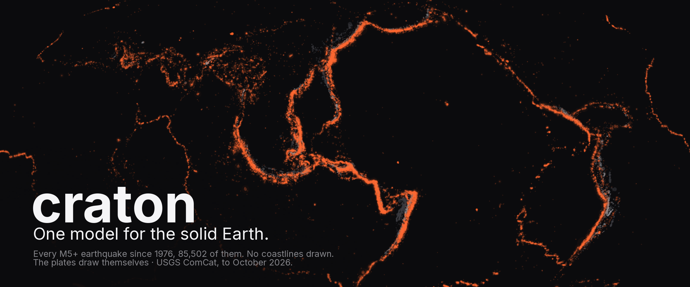
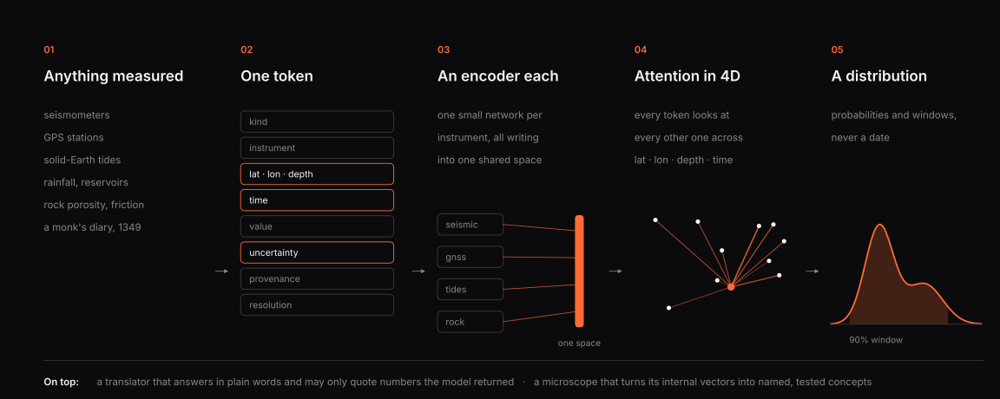
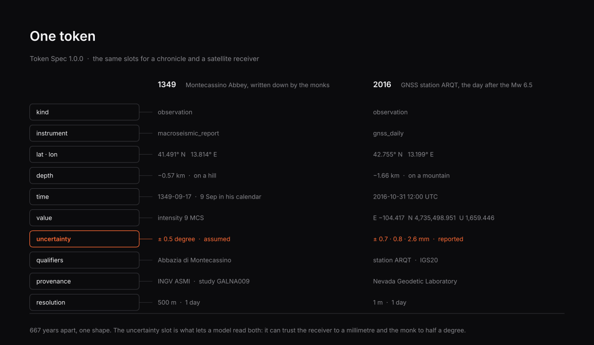
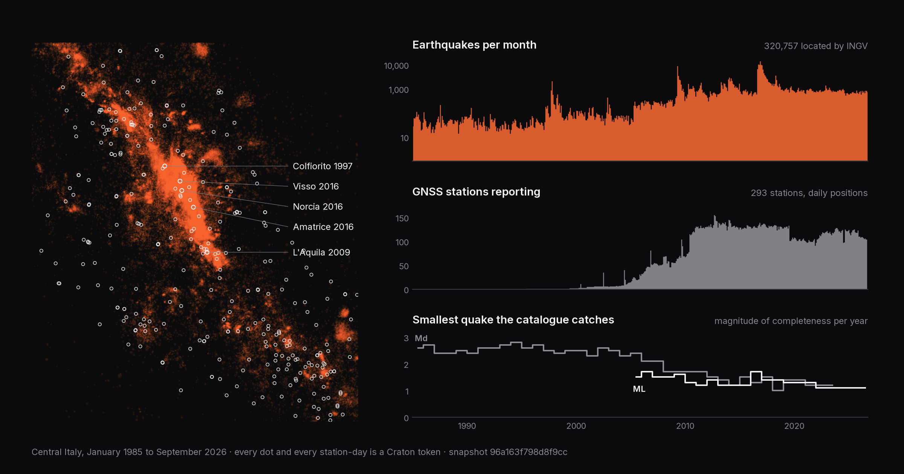
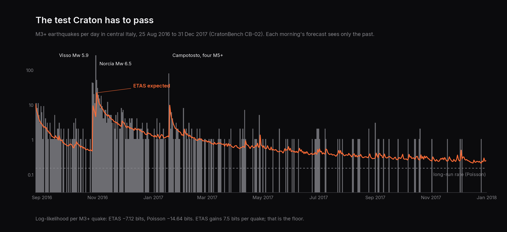
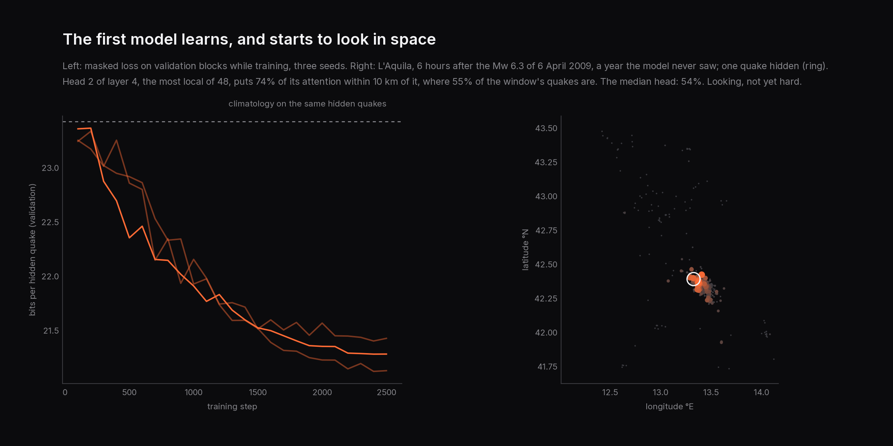
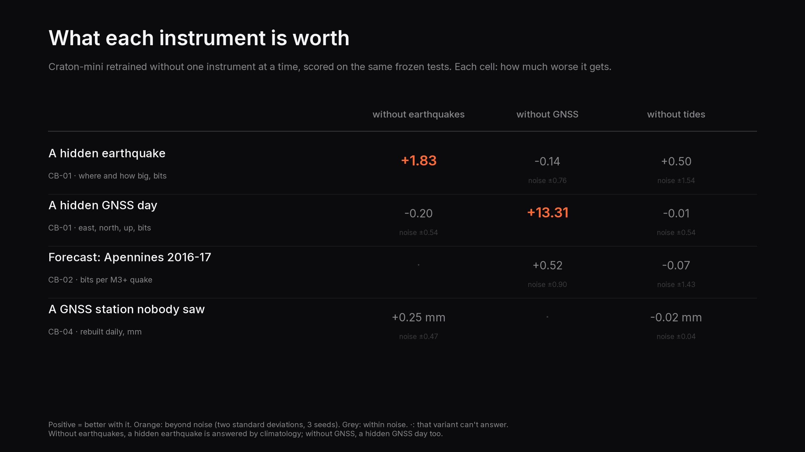
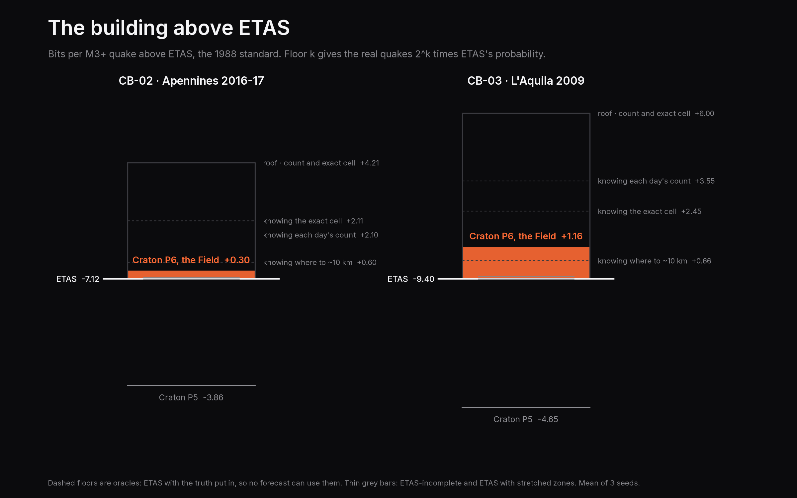

<p align="center">
  <picture>
    <source media="(prefers-color-scheme: dark)" srcset="docs/assets/hero-dark.png">
    <source media="(prefers-color-scheme: light)" srcset="docs/assets/hero-light.png">
    
  </picture>
</p>

<p align="center">
  <b>A foundation model for the solid Earth, built the way LLMs are built.</b><br>
  One token for every measurement. One objective. One operation.<br>
  And a benchmark suite that only lets it get better.
</p>

<p align="center">
  <a href="https://github.com/AhmedHeshamEG/craton/actions/workflows/ci.yml"></a>
  <a href="ROADMAP.md"></a>
  <a href="LICENSE"></a>
  
  
</p>

---

## The idea

Language models got good when someone decided that all text, every book and forum and recipe, could be
cut into one kind of token, and one model could learn by filling in the blanks.

The solid Earth never had that moment. Seismometers have their models, GPS has its models, tide gauges and
rock labs and catalogue historians have theirs, and none of them read each other. Nothing reads the
seismometer, the GPS antenna, the pull of the Moon and a monk's diary from 1349 at the same time.

Craton is that one model.

- **One token.** Every measurement on Earth becomes the same shape:
  `kind · instrument · lat, lon, depth · time · value · uncertainty · provenance · resolution`.
  A seismogram window, a day of GPS, a tidal stress, a rock's porosity, a line in a medieval chronicle. The
  monk is just a sensor with a very large uncertainty slot.
- **One objective.** Hide any token, predict it from the rest. The past and the future are the same game; the
  holes are just in different places.
- **One operation.** Attention across space and time, with positions in four dimensions.

<p align="center">
  <picture>
    <source media="(prefers-color-scheme: dark)" srcset="docs/assets/how-it-works-dark.svg">
    <source media="(prefers-color-scheme: light)" srcset="docs/assets/how-it-works-light.svg">
    
  </picture>
</p>

## One token, frozen

<p align="center">
  <picture>
    <source media="(prefers-color-scheme: dark)" srcset="docs/assets/token-dark.svg">
    <source media="(prefers-color-scheme: light)" srcset="docs/assets/token-light.svg">
    
  </picture>
</p>

Token Spec 1.0.0 is out and frozen: 11 instruments, from earthquakes and GNSS to porosity, lithology and
friction. A validator refuses anything malformed with a named reason, and the spec can only grow: removing or
redefining anything fails the check. Read it in [`docs/token-spec.md`](docs/token-spec.md), the rules in
[`SPEC_POLICY.md`](SPEC_POLICY.md), or run `uv run craton spec`.

## First data

<p align="center">
  <picture>
    <source media="(prefers-color-scheme: dark)" srcset="docs/assets/coverage-dark.png">
    <source media="(prefers-color-scheme: light)" srcset="docs/assets/coverage-light.png">
    
  </picture>
</p>

Central Italy, January 1985 to September 2026, is now **1,758,860 tokens**: 320,757 earthquakes from INGV,
751,394 days of position from 293 GNSS stations, and 686,709 solid-Earth tides that Craton computes itself
with the IERS 2010 model, one at the moment of every earthquake. Every token points back to the exact bytes
its provider served, and building twice from the same downloads gives the same files, byte for byte.

The bottom timeline is why this matters. In 1985 the catalogue was only complete above magnitude 2.6; today
it is complete down to 1.1. It recorded 718 earthquakes in 1990 and 10,273 in 2023. A model that doesn't
know about the network would conclude Italy got fourteen times more active. It didn't. The ears got better.

```console
uv run craton data fetch central_italy    # once: ~185 MB, one polite request a second
uv run craton data build central_italy    # offline, ~8 minutes, same snapshot id every time
```

Who made each dataset, its licence and how to cite it: [`docs/data/`](docs/data/).

## What it will never tell you

The date of the next big earthquake.

Big earthquakes are rare, the stress that triggers them sits 15 km down where nothing can measure it, and
Parkfield taught seismology humility: a fault that was "due" around 1988 broke in 2004, under a forest of
instruments, with no clear warning. So every Craton output is a **distribution**: a probability, an
ensemble, a window with a stated resolution. The project tracks how wide that window is, and calls it the
predictability meter. Every version has to shrink it, or it doesn't count as progress.

## Three numbers

| | What it asks | Twin in the LLM world |
|---|---|---|
| **Geo-perplexity** | How surprised is the model by real Earth data it has never seen? | Perplexity |
| **Predictability meter** | How wide is the 90% window, in days, kilometres and magnitude? | Calibrated uncertainty |
| **Information gain over ETAS** | Does it beat the standard statistical model on a real sequence (Amatrice–Norcia, 2016–17)? | Beating the strong baseline |

The simple methods were scored first, so the first model had something honest to beat. Live numbers:
[`SCOREBOARD.md`](SCOREBOARD.md).

## The test before the model

<p align="center">
  <picture>
    <source media="(prefers-color-scheme: dark)" srcset="docs/assets/apennines-forecast-dark.png">
    <source media="(prefers-color-scheme: light)" srcset="docs/assets/apennines-forecast-light.png">
    
  </picture>
</p>

Four tests, **CratonBench v1**, frozen before any model exists. The 2016-17 Apennines sequence and 2009
(L'Aquila) are held out of training forever, and so is one GNSS station in ten. The training data is cut
into files, and `craton bench leaks` reads all 2.5 million training tokens back to prove no answer got in.

The floor every Craton model has to clear:

| Test | Best simple method | Score |
|---|---|---|
| **CB-01** Geo-perplexity: guess hidden measurements back | climatology | 22.7 bits per token |
| **CB-02** Forecast the Apennines, every day for 494 days | ETAS | −7.12 bits per M3+ quake |
| **CB-03** Forecast 2009, fitted only on the years before | ETAS | −9.40 bits per M3+ quake |
| **CB-04** Rebuild a GPS station nobody let you see | its neighbours, weighted | 17.8 mm |

ETAS, the standard aftershock model, beats a flat long-run rate by 7.5 bits per quake on the Apennines:
it gives what actually happened about 180 times more probability. It is still surprised. It expected 583
M3+ quakes and 1,065 came, most of them in the days after Visso and Norcia. That gap is what Craton is for.
How every test works: [`docs/bench.md`](docs/bench.md).

## The first model

<p align="center">
  <picture>
    <source media="(prefers-color-scheme: dark)" srcset="docs/assets/first-model-dark.png">
    <source media="(prefers-color-scheme: light)" srcset="docs/assets/first-model-light.png">
    
  </picture>
</p>

**Craton-mini v0** is a 4.7-million-parameter transformer that reads the earthquake catalogue: one
encoder for quakes, rotary positions over time, latitude, longitude and depth, six GPT-2 layers, and two
heads that only ever answer with probabilities. It plays two games: hide a quake and guess where it was
and how big, and stand at midnight and forecast tomorrow. Each run trains in 8 to 16 minutes on a laptop
RTX 2060 and peaks at 2.6 GB.

| Test | Craton-mini v0 | The floor |
|---|---|---|
| **CB-01** Guess hidden measurements back | **21.66 bits** | climatology 22.66: beaten |
| **CB-02** Forecast the Apennines 2016-17 | **−10.88 bits** per M3+ quake | ETAS −7.12: lost · Poisson −14.64: beaten |
| **CB-03** Forecast 2009 | **−15.13 bits** per M3+ quake | ETAS −9.40: lost · Poisson −16.94: beaten |

It loses to ETAS, and the scoreboard says so. ETAS is a theory with a handful of parameters; the model has
to learn the same laws from thirty years of one region, with 13 truly busy days in it. GPS and tides (P5)
and simulated planets (P7) are how that gap gets closed. How it works, step by step:
[`lessons/P4.md`](lessons/P4.md). Model cards: [`docs/models/craton-mini.md`](docs/models/craton-mini.md).

## Three instruments, one model

<p align="center">
  <picture>
    <source media="(prefers-color-scheme: dark)" srcset="docs/assets/ablation-dark.png">
    <source media="(prefers-color-scheme: light)" srcset="docs/assets/ablation-light.png">
    
  </picture>
</p>

Craton-mini now reads the earthquake catalogue, daily GPS positions and the solid-Earth tide at once:
one encoder per instrument, one trunk, one shared space. A GPS day is read as its distance from the
station's own long-term line; a station nobody has seen borrows its line from its neighbours.

| Test | Craton-mini (P5) | Before (P4) | The floor |
|---|---|---|---|
| **CB-01** Guess hidden measurements back | **15.12 bits** | 21.66 | climatology 22.66 |
| · a hidden GPS day | **9.75 bits** | — | 22.83 |
| · a hidden quake | 20.48 bits | 20.49 | 22.48 |
| **CB-02** Forecast the Apennines 2016-17 | −10.98 | −10.88 | ETAS −7.12 |
| **CB-03** Forecast 2009 | −14.05 | −15.13 | ETAS −9.40 |
| **CB-04** Rebuild a GPS station nobody let you see | **17.50 mm** | — | its neighbours 17.77 |
| **CB-17** Learn a region never seen, from its first year | 24.56 bits | — | counting it 19.03 |

GPS is worth thirteen bits on GPS and nothing on quakes. The Moon's tide is worth nothing at all,
within noise: tidal triggering is real but tiny, and a measured zero is a result. ETAS still wins both
forecasts. The model learns a new region from context alone (7.9 bits from one year of it), but
counting that year still beats it. Step by step, including the training mix that almost hid a loss:
[`lessons/P5.md`](lessons/P5.md). Every share: [`docs/ablation.md`](docs/ablation.md).

## Above ETAS

<p align="center">
  <picture>
    <source media="(prefers-color-scheme: dark)" srcset="docs/assets/building-dark.png">
    <source media="(prefers-color-scheme: light)" srcset="docs/assets/building-light.png">
    
  </picture>
</p>

Two phases in a row Craton lost to ETAS, by four to five bits per quake. Split, the loss was mostly
*where*, and the cause was structural: inside a sequence the model's 1,024-quake window reached back less
than three days, and one vector had to hold a map of 1,050 places.

So the forecast was rebuilt as **the Field**. Every 0.1° cell is a token with a fading memory of its
quakes, from an hour to twelve years (a power law is a sum of exponentials, so ETAS's whole memory is one
recipe over these counters). The cells attend to each other. And the Field *starts as ETAS*: it learns
only a correction, at most 4x either way.

| Test | Craton-mini (P6) | Before (P5) | ETAS | Strongest floor |
|---|---|---|---|---|
| **CB-02** Forecast the Apennines 2016-17 | **−6.82 ± 0.02** | −10.98 | −7.12 | ETAS-incomplete −7.06 |
| **CB-03** Forecast 2009 | **−8.23 ± 0.01** | −14.05 | −9.40 | ETAS-incomplete −9.30 |

Bits per M3+ quake, higher is better. On L'Aquila the real quakes get 2.2 times ETAS's probability; on
the Apennines, 1.2 times. Most of it is *how many*. *Where* beats ETAS on 2009 and is 0.02 bits behind on
2016-17, all of it on the two days a new mainshock struck away from the swarm (Norcia, Campotosto); without
the M5+ days, ETAS still edges the Apennines. Above it all, the oracles: the room up to the roof is +4.2
and +6.0 bits. The honest GNSS floor arrived too: drawing a line between a station's neighbouring days
(9.65 bits) beats Craton's 9.75. Step by step: [`lessons/P6.md`](lessons/P6.md).

## Built like a building

You don't redesign the foundation every time you add a floor. Craton is constructive-only:

- **The token spec is frozen once released.** New versions may only *add* fields and instruments. Data written
  in 2026 stays valid forever.
- **Data is immutable.** Every download and token file is content-hashed; corrections arrive as new versions.
- **Benchmarks are immutable.** A test's data and metric never change. A better test gets a new ID.
- **The ratchet.** A change lands only if no benchmark gets worse beyond noise (2σ over 3 seeds), compared
  with the best score ever recorded, so small losses can't quietly stack up.
- **Every number comes from a script.** `SCOREBOARD.md` is generated; the check fails if a human edits it.
- **The logbook and decisions are append-only.** Mistakes get corrected below, never erased.

All of it is one command, the same on a laptop and on CI:

```console
$ uv run craton check
✓ lint · ✓ format · ✓ types · ✓ tests · ✓ scoreboard is generated · ✓ records append-only
✓ benchmarks frozen, no leaks · ✓ ratchet
all green. The foundation holds.
```

## One codebase, three sizes

The only difference between them is a YAML file in [`configs/`](configs/).

| | Trunk | Shape | Context | Where |
|---|---|---|---|---|
| **Craton-mini** | 4.74M | d=256 × 6 layers | 1,024 tokens | a laptop RTX 2060, 6 GB, central Italy |
| **Craton-regional** | 85.1M | d=768 × 12 layers | 8,192 tokens | one rented A100 |
| **Craton-planet** | 1.61B | d=2048 × 32 layers | 131,072 tokens | a GPU cluster, once the scaling law says so |

Parameter counts come from `craton config <size>`, and a config that lies about its own size fails to load.

## Roadmap

```
CORE       ██████████████████████████░░░░   7/8    foundation → beat ETAS → a model that knows when it doesn't know
DISCOVERY  ░░░░░░░░░░░░░░░░░░░░░░░░░░░░░░   0/4    fake planets, the ghost channel, the translator, the microscope
SCALE      ░░░░░░░░░░░░░░░░░░░░░░░░░░░░░░   0/2    any time horizon, then mini → regional → planet
```

| | Phase | Borrowed from the LLM world |
|---|---|---|
| ✅ | **P0** Foundation: repo, checks, the ratchet | the training-infra repo every lab builds first |
| ✅ | **P1** The universal token, frozen | the tokenizer |
| ✅ | **P2** First data: INGV catalogue, GNSS, tides | the data pipeline |
| ✅ | **P3** CratonBench + baselines, before any model | the eval harness |
| ✅ | **P4** Craton-mini v0, the first transformer | the GPT-2 small run |
| ✅ | **P5** Fusion: quakes + GPS + the Moon | multimodal models |
| ✅ | **P6** Beat ETAS: the Field | state-space memory, residual learning, ensembles |
| ◻️ | **P7** The 8 locks: knowing when it doesn't know | calibration, ensembles, red-teaming |
| ◻️ | **P8** Fake planets: pretraining on simulated millennia | synthetic data |
| ◻️ | **P9** The ghost channel: forces we forgot | register tokens |
| ◻️ | **P10** The translator: plain-language answers, numbers only from the model | tool use |
| ◻️ | **P11** The microscope: what the model learned | sparse autoencoders |
| ◻️ | **P12** Any horizon, from next week to a million years | long context |
| ◻️ | **P13** Scale-ready, open to every dataset | scaling laws, LoRA |

The full plan, with every benchmark and exit test: [`ROADMAP.md`](ROADMAP.md).

## Quickstart

```console
git clone https://github.com/AhmedHeshamEG/craton && cd craton
uv sync --extra cu126      # NVIDIA GPU   (no NVIDIA: uv sync --extra cpu)
uv run craton doctor       # what this machine can run, and how
uv run craton check        # everything that has to pass before a change lands
uv run craton spec example montecassino_1349   # the monk's diary, as a token
```

With the data built (`craton data fetch central_italy`, `craton data build central_italy`,
`craton bench prepare`), train and score the first model:

```console
uv run craton train cb03_fit --seeds 0    # one model, its checkpoint and model card
uv run craton bench run craton-mini       # all three seeds on every task it supports
```

On the laptop it was built on, `craton doctor --smoke` says:

```console
machine  Windows 11 · Python 3.11.9 · 15.8 GiB RAM
pytorch  2.14.1+cu126 (CUDA 12.6)
gpu      NVIDIA GeForce RTX 2060 · 6 GiB · Turing sm_75
fp16     ✓ tensor cores · trains with gradient scaling
bf16     ✗ not on Turing · a bf16 request becomes fp16

 size       status    trunk   d × layers   context   precision here
 mini       active    4.74M   256 × 6      1,024     fp16 + scaler
 regional   planned   85.1M   768 × 12     8,192     bf16 → fp16 + scaler
 planet     planned   1.61B   2048 × 32    131,072   bf16 → fp16 + scaler

✓ smoke: 60 fp16 steps on cuda · loss 0.522 → 0.001 · peak 17.4 MiB
ready: Craton-mini trains on this GPU.
```

Needs [uv](https://docs.astral.sh/uv/) and Python 3.11+.

## Learn along

Every phase ships a lesson in [`lessons/`](lessons/), written for a smart friend who has never trained a model:
the idea step by step, the LLM analogy and where it breaks, the code in the order data flows, and a few
commands to run it yourself. Follow the phases and you've built a foundation model from an empty folder.

## Contributing

Adapters for new data, new forces, new benchmarks: everything plugs in through registries, nothing edits the
core, and the ratchet guards the rest. Start with [`CONTRIBUTING.md`](CONTRIBUTING.md).

## Credits

Hero data: [USGS ComCat](https://earthquake.usgs.gov/earthquakes/search/) (public domain), drawn by
[`scripts/figures/banner.py`](scripts/figures/banner.py). Central Italy: [INGV ISIDe](https://doi.org/10.13127/ISIDE)
(CC-BY-4.0) and the [Nevada Geodetic Laboratory](https://geodesy.unr.edu/) (Blewitt et al. 2018); the tide
follows the IERS Conventions (2010). Type: [Inter](https://rsms.me/inter/) (SIL OFL).
Craton stands on SeisLM, ETAS, CSEP and pyCSEP, GraphCast's lesson about reanalysis, and decades of open
catalogues from INGV and the Nevada Geodetic Laboratory. Full sources per phase in the lessons.

## Citing

See [`CITATION.cff`](CITATION.cff), or GitHub's "Cite this repository" button.

## License

Code: [Apache-2.0](LICENSE). Every dataset keeps its own licence, recorded in its data card.

<sub>A craton is the ancient core of a continent: rock that hasn't deformed in billions of years, while new crust
keeps docking onto its edges. That's the rule for this repo.</sub>
