<p align="center">
  <picture>
    <source media="(prefers-color-scheme: dark)" srcset="docs/assets/hero-dark.png">
    <source media="(prefers-color-scheme: light)" srcset="docs/assets/hero-light.png">
    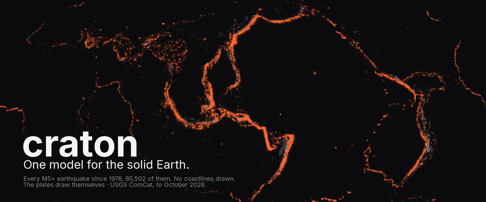
  </picture>
</p>

<p align="center">
  <b>A foundation model for the solid Earth, built the way LLMs are built.</b><br>
  One token for every measurement. One objective. One operation.<br>
  And a benchmark suite that only lets it get better.
</p>

<p align="center">
  <a href="https://github.com/AhmedHeshamEG/craton/actions/workflows/ci.yml"></a>
  <a href="ROADMAP.md"></a>
  <a href="LICENSE"></a>
  
  
</p>

---

## The idea

Language models got good when someone decided that all text, every book and forum and recipe, could be
cut into one kind of token, and one model could learn by filling in the blanks.

The solid Earth never had that moment. Seismometers have their models, GPS has its models, tide gauges and
rock labs and catalogue historians have theirs, and none of them read each other. Nothing reads the
seismometer, the GPS antenna, the pull of the Moon and a monk's diary from 1349 at the same time.

Craton is that one model.

- **One token.** Every measurement on Earth becomes the same shape:
  `kind · instrument · lat, lon, depth · time · value · uncertainty · provenance · resolution`.
  A seismogram window, a day of GPS, a tidal stress, a rock's porosity, a line in a medieval chronicle. The
  monk is just a sensor with a very large uncertainty slot.
- **One objective.** Hide any token, predict it from the rest. The past and the future are the same game; the
  holes are just in different places.
- **One operation.** Attention across space and time, with positions in four dimensions.

<p align="center">
  <picture>
    <source media="(prefers-color-scheme: dark)" srcset="docs/assets/how-it-works-dark.svg">
    <source media="(prefers-color-scheme: light)" srcset="docs/assets/how-it-works-light.svg">
    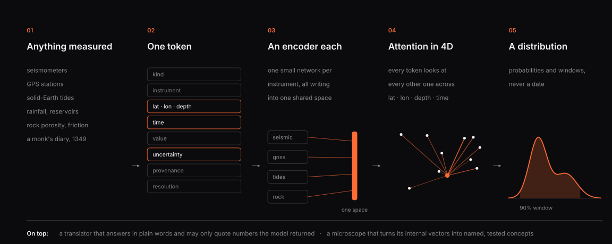
  </picture>
</p>

The model that forecasts today, the Field, on real data: midnight after the 2016 Norcia earthquake, ETAS
makes its forecast, every square of central Italy looks at the others, and the Field nudges ETAS up or down.
Five short clips, from the map to the whole world, are on the
[project page](https://ahmedheshameg.github.io/craton/#how).

<p align="center">
  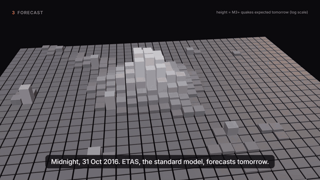
</p>

## One token, frozen

<p align="center">
  <picture>
    <source media="(prefers-color-scheme: dark)" srcset="docs/assets/token-dark.svg">
    <source media="(prefers-color-scheme: light)" srcset="docs/assets/token-light.svg">
    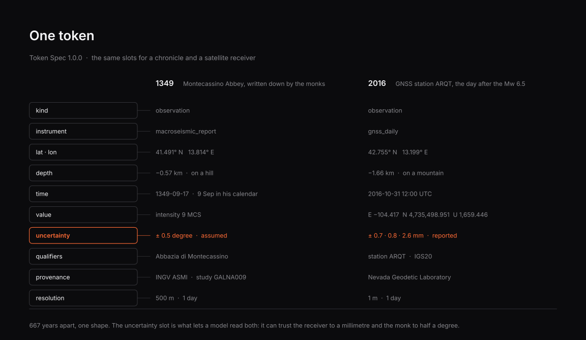
  </picture>
</p>

Token Spec 1.0.0 is out and frozen: 11 instruments, from earthquakes and GNSS to porosity, lithology and
friction. A validator refuses anything malformed with a named reason, and the spec can only grow: removing or
redefining anything fails the check. Read it in [`docs/token-spec.md`](docs/token-spec.md), the rules in
[`SPEC_POLICY.md`](SPEC_POLICY.md), or run `uv run craton spec`.

## First data

<p align="center">
  <picture>
    <source media="(prefers-color-scheme: dark)" srcset="docs/assets/coverage-dark.png">
    <source media="(prefers-color-scheme: light)" srcset="docs/assets/coverage-light.png">
    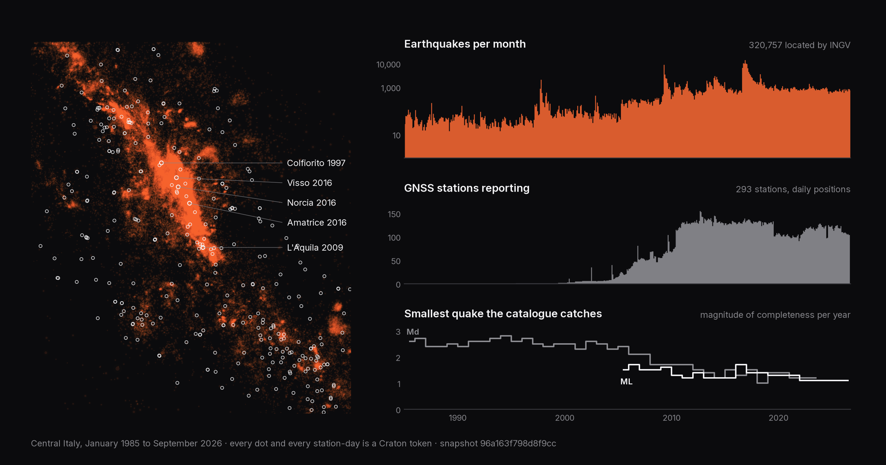
  </picture>
</p>

Central Italy, January 1985 to September 2026, is now **1,758,860 tokens**: 320,757 earthquakes from INGV,
751,394 days of position from 293 GNSS stations, and 686,709 solid-Earth tides that Craton computes itself
with the IERS 2010 model, one at the moment of every earthquake. Every token points back to the exact bytes
its provider served, and building twice from the same downloads gives the same files, byte for byte.

The bottom timeline is why this matters. In 1985 the catalogue was only complete above magnitude 2.6; today
it is complete down to 1.1. It recorded 718 earthquakes in 1990 and 10,273 in 2023. A model that doesn't
know about the network would conclude Italy got fourteen times more active. It didn't. The ears got better.

```console
uv run craton data fetch central_italy    # once: ~185 MB, one polite request a second
uv run craton data build central_italy    # offline, ~8 minutes, same snapshot id every time
```

Who made each dataset, its licence and how to cite it: [`docs/data/`](docs/data/).

## What it will never tell you

The date of the next big earthquake.

Big earthquakes are rare, the stress that triggers them sits 15 km down where nothing can measure it, and
Parkfield taught seismology humility: a fault that was "due" around 1988 broke in 2004, under a forest of
instruments, with no clear warning. So every Craton output is a **distribution**: a probability, an
ensemble, a window with a stated resolution. The project tracks how wide that window is, and calls it the
predictability meter. Every version has to shrink it, or it doesn't count as progress.

## Three numbers

| | What it asks | Twin in the LLM world |
|---|---|---|
| **Geo-perplexity** | How surprised is the model by real Earth data it has never seen? | Perplexity |
| **Predictability meter** | How wide is the 90% window, in days, kilometres and magnitude? | Calibrated uncertainty |
| **Information gain over ETAS** | Does it beat the standard statistical model on a real sequence (Amatrice–Norcia, 2016–17)? | Beating the strong baseline |

**What a bit is.** Most scores on this page are in bits per quake. A forecast is a bet: how many quakes
tomorrow, and on which squares of the map. The bet is a fixed budget, so painting the whole map red loses.
When a quake happens, the score asks how much of the bet sat on that square that day. Twice ETAS's share is
+1 bit, the same share is 0, half is −1. Averaged over every quake in a test, +0.30 bits means the real
quakes got 1.2 times ETAS's probability, and +1.16 means 2.2 times.

<p align="center">
  <picture>
    <source media="(prefers-color-scheme: dark)" srcset="docs/assets/bits-dark.svg">
    <source media="(prefers-color-scheme: light)" srcset="docs/assets/bits-light.svg">
    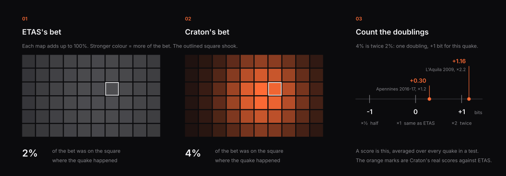
  </picture>
</p>

The simple methods were scored first, so the first model had something honest to beat. Live numbers:
[`SCOREBOARD.md`](SCOREBOARD.md), and drawn, with every chart you can hover, on
[the project page](https://ahmedheshameg.github.io/craton/).

<p align="center">
  <picture>
    <source media="(prefers-color-scheme: dark)" srcset="docs/assets/scorecard-dark.png">
    <source media="(prefers-color-scheme: light)" srcset="docs/assets/scorecard-light.png">
    
  </picture>
</p>

## The test before the model

<p align="center">
  <picture>
    <source media="(prefers-color-scheme: dark)" srcset="docs/assets/apennines-forecast-dark.png">
    <source media="(prefers-color-scheme: light)" srcset="docs/assets/apennines-forecast-light.png">
    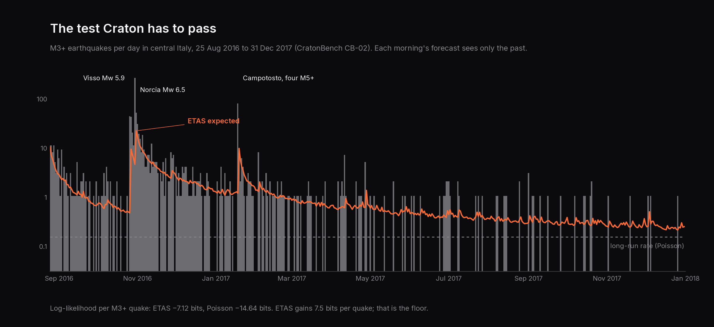
  </picture>
</p>

Four tests, **CratonBench v1**, frozen before any model exists. The 2016-17 Apennines sequence and 2009
(L'Aquila) are held out of training forever, and so is one GNSS station in ten. The training data is cut
into files, and `craton bench leaks` reads all 2.5 million training tokens back to prove no answer got in.

The floor every Craton model has to clear:

| Test | Best simple method | Score |
|---|---|---|
| **CB-01** Geo-perplexity: guess hidden measurements back | climatology | 22.7 bits per token |
| **CB-02** Forecast the Apennines, every day for 494 days | ETAS | −7.12 bits per M3+ quake |
| **CB-03** Forecast 2009, fitted only on the years before | ETAS | −9.40 bits per M3+ quake |
| **CB-04** Rebuild a GPS station nobody let you see | its neighbours, weighted | 17.8 mm |

ETAS, the standard aftershock model, beats a flat long-run rate by 7.5 bits per quake on the Apennines:
it gives what actually happened about 180 times more probability. It is still surprised. It expected 583
M3+ quakes and 1,065 came, most of them in the days after Visso and Norcia. That gap is what Craton is for.
How every test works: [`docs/bench.md`](docs/bench.md).

## The first model

<p align="center">
  <picture>
    <source media="(prefers-color-scheme: dark)" srcset="docs/assets/first-model-dark.png">
    <source media="(prefers-color-scheme: light)" srcset="docs/assets/first-model-light.png">
    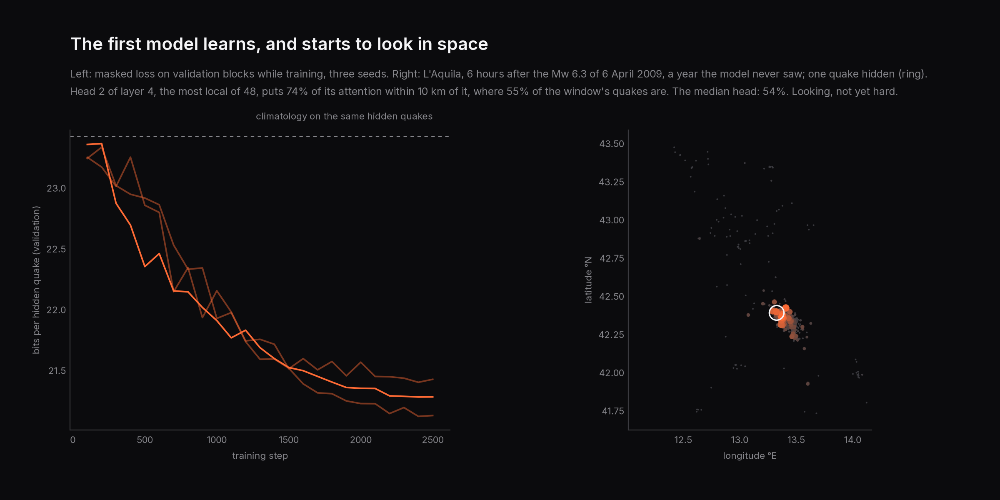
  </picture>
</p>

**Craton-mini v0** is a 4.7-million-parameter transformer that reads the earthquake catalogue: one
encoder for quakes, rotary positions over time, latitude, longitude and depth, six GPT-2 layers, and two
heads that only ever answer with probabilities. It plays two games: hide a quake and guess where it was
and how big, and stand at midnight and forecast tomorrow. Each run trains in 8 to 16 minutes on a laptop
RTX 2060 and peaks at 2.6 GB.

| Test | Craton-mini v0 | The floor |
|---|---|---|
| **CB-01** Guess hidden measurements back | **21.66 bits** | climatology 22.66: beaten |
| **CB-02** Forecast the Apennines 2016-17 | **−10.88 bits** per M3+ quake | ETAS −7.12: lost · Poisson −14.64: beaten |
| **CB-03** Forecast 2009 | **−15.13 bits** per M3+ quake | ETAS −9.40: lost · Poisson −16.94: beaten |

It loses to ETAS, and the scoreboard says so. ETAS is a theory with a handful of parameters; the model has
to learn the same laws from thirty years of one region, with 13 truly busy days in it. GPS and tides (P5)
and simulated planets (P7) are how that gap gets closed. How it works, step by step:
[`lessons/P4.md`](lessons/P4.md). Model cards: [`docs/models/craton-mini.md`](docs/models/craton-mini.md).

## Three instruments, one model

<p align="center">
  <picture>
    <source media="(prefers-color-scheme: dark)" srcset="docs/assets/ablation-dark.png">
    <source media="(prefers-color-scheme: light)" srcset="docs/assets/ablation-light.png">
    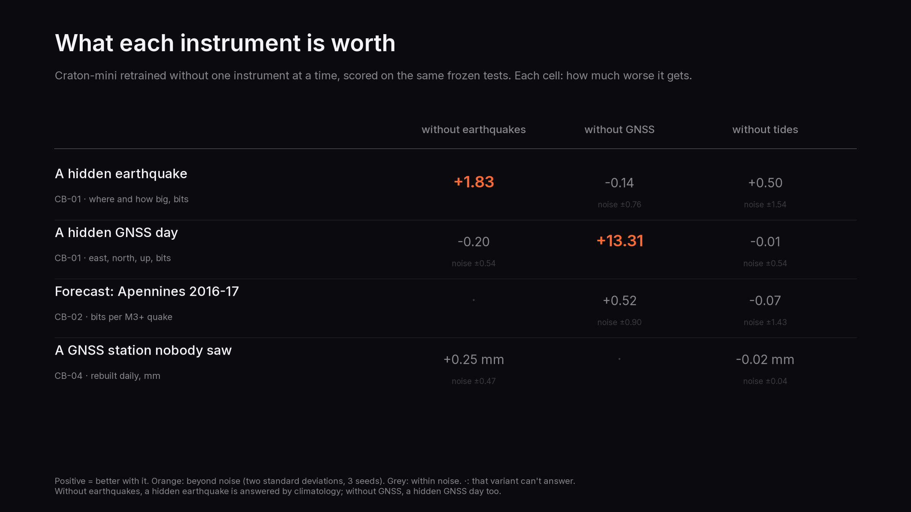
  </picture>
</p>

Craton-mini now reads the earthquake catalogue, daily GPS positions and the solid-Earth tide at once:
one encoder per instrument, one trunk, one shared space. A GPS day is read as its distance from the
station's own long-term line; a station nobody has seen borrows its line from its neighbours.

| Test | Craton-mini (P5) | Before (P4) | The floor |
|---|---|---|---|
| **CB-01** Guess hidden measurements back | **15.12 bits** | 21.66 | climatology 22.66 |
| · a hidden GPS day | **9.75 bits** | — | 22.83 |
| · a hidden quake | 20.48 bits | 20.49 | 22.48 |
| **CB-02** Forecast the Apennines 2016-17 | −10.98 | −10.88 | ETAS −7.12 |
| **CB-03** Forecast 2009 | −14.05 | −15.13 | ETAS −9.40 |
| **CB-04** Rebuild a GPS station nobody let you see | **17.50 mm** | — | its neighbours 17.77 |
| **CB-17** Learn a region never seen, from its first year | 24.56 bits | — | counting it 19.03 |

GPS is worth thirteen bits on GPS and nothing on quakes. The Moon's tide is worth nothing at all,
within noise: tidal triggering is real but tiny, and a measured zero is a result. ETAS still wins both
forecasts. The model learns a new region from context alone (7.9 bits from one year of it), but
counting that year still beats it. Step by step, including the training mix that almost hid a loss:
[`lessons/P5.md`](lessons/P5.md). Every share: [`docs/ablation.md`](docs/ablation.md).

## Above ETAS

<p align="center">
  <picture>
    <source media="(prefers-color-scheme: dark)" srcset="docs/assets/building-dark.png">
    <source media="(prefers-color-scheme: light)" srcset="docs/assets/building-light.png">
    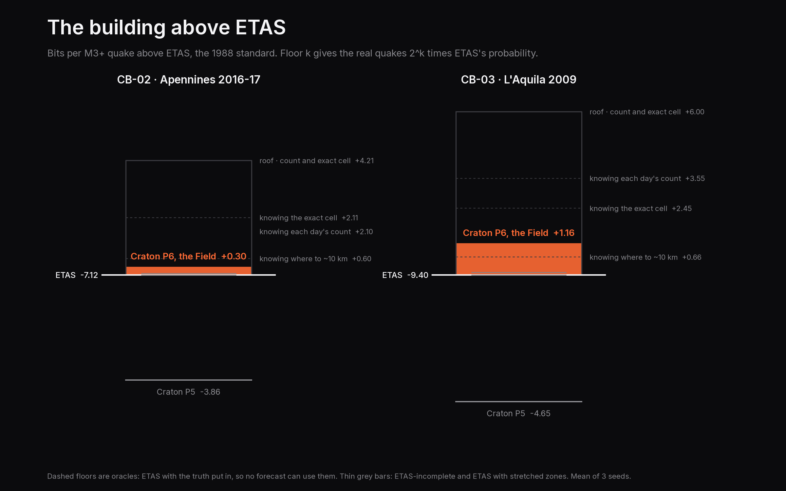
  </picture>
</p>

Two phases in a row Craton lost to ETAS, by four to five bits per quake. Split, the loss was mostly
*where*, and the cause was structural: inside a sequence the model's 1,024-quake window reached back less
than three days, and one vector had to hold a map of 1,050 places.

So the forecast was rebuilt as **the Field**. Every 0.1° cell is a token with a fading memory of its
quakes, from an hour to twelve years (a power law is a sum of exponentials, so ETAS's whole memory is one
recipe over these counters). The cells attend to each other. And the Field *starts as ETAS*: it learns
only a correction, at most 4x either way.

| Test | Craton-mini (P6) | Before (P5) | ETAS | Strongest floor |
|---|---|---|---|---|
| **CB-02** Forecast the Apennines 2016-17 | **−6.82 ± 0.02** | −10.98 | −7.12 | ETAS-incomplete −7.06 |
| **CB-03** Forecast 2009 | **−8.23 ± 0.01** | −14.05 | −9.40 | ETAS-incomplete −9.30 |

Bits per M3+ quake, higher is better. On L'Aquila the real quakes get 2.2 times ETAS's probability; on
the Apennines, 1.2 times. Most of it is *how many*. *Where* beats ETAS on 2009 and is 0.02 bits behind on
2016-17, all of it on the two days a new mainshock struck away from the swarm (Norcia, Campotosto); without
the M5+ days, ETAS still edges the Apennines. Above it all, the oracles: the room up to the roof is +4.2
and +6.0 bits. The honest GNSS floor arrived too: drawing a line between a station's neighbouring days
(9.65 bits) beats Craton's 9.75. Step by step: [`lessons/P6.md`](lessons/P6.md).

## Knowing when it doesn't know

<p align="center">
  <picture>
    <source media="(prefers-color-scheme: dark)" srcset="docs/assets/meter-dark.png">
    <source media="(prefers-color-scheme: light)" srcset="docs/assets/meter-light.png">
    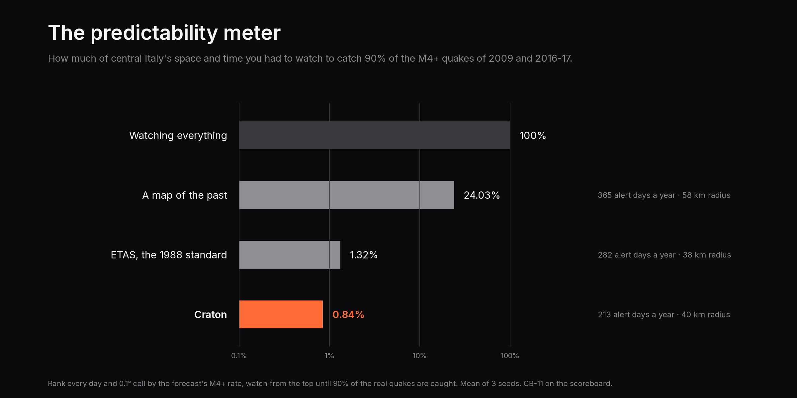
  </picture>
</p>

A confidently wrong earthquake model is worse than none. So before Craton learns anything new, it has to
pass the locks: the tests that killed every false precursor in the history of the field.

| Lock | The test | Craton | Best floor |
|---|---|---|---|
| **The meter** (CB-11) | Share of space-time you watch to catch 90% of the M4+ quakes | **0.84%** | ETAS 1.32% |
| **Physics** (CB-08) | Negative rates, more big quakes than small, rising rates with no new quakes, the slip budget | **0 violations** | ETAS: 1, the slip budget |
| **Never seen this** (CB-06) | Tell Calabria + Sicily from central Italy, by the kind of seismicity, not the place | 0.997 | fingerprint 0.998 |
| **Calibration** (CB-05) | Does "1%" happen 1% of the time? Times off, in doublings | 0.32 | ETAS-incomplete 0.10 |
| **Fake precursors** (CB-07) | False alarms when the inputs carry glitches, ÷ clean | 1.002 | ETAS 1.002 |

The meter is where it shows: to catch 90% of the M4+ quakes of 2009 and 2016-17, Craton puts you on alert 213
days a year, ETAS 282. It never breaks physics; every ETAS variant promises more seismic moment than the
Apennines can store, because its magnitudes run to M8. It knows when it is somewhere new, though it needs a
hand-made fingerprint to tell: its own vectors find central Italy's sequences stranger than Sicily. Its day
totals are the best calibrated of any method; cell by cell it is still a third of a doubling off. And one
glitch, a magnitude shift, leaks past its input guard on one seed out of three. That miss is on the board too.

**Every night, a forecast nobody can change.** Before midnight UTC a GitHub job runs the frozen model of this
release on the latest INGV catalogue, writes tomorrow's forecast for central Italy with ETAS's beside it,
seals it with a SHA-256 hash and pushes it to [`forecasts/`](forecasts/). Three days later the day is graded.
Nothing is backfilled, and the check refuses any edit to a locked file. Running score:
[`forecasts/README.md`](forecasts/README.md).

**The referee.** The day before this phase, aftershocks in central Italy looked locked to the solid-Earth
tide. `craton referee` replays it: raw p = 10⁻⁴¹³; with the aftershocks removed it survives (10⁻³·³); it even
"predicts" 2009 at the same phase (10⁻³·⁹). Then the tide is slid by random lags, and the fake tides lock as
hard 71% of the time. The tide's phase isn't spread evenly over time, and the test assumed it was. Rejected. A
planted 12.42-hour signal passes all five tests. Step by step: [`lessons/P7.md`](lessons/P7.md).

## Two fake planets

<p align="center">
  <picture>
    <source media="(prefers-color-scheme: dark)" srcset="docs/assets/planets-dark.png">
    <source media="(prefers-color-scheme: light)" srcset="docs/assets/planets-light.png">
    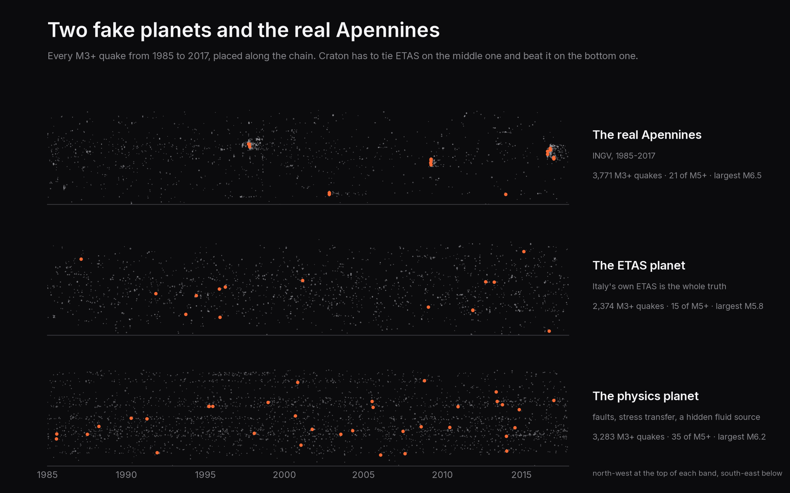
  </picture>
</p>

Central Italy has three big sequences in forty years, so any score on it is part luck, and there's no way to
tell which part. On a simulated planet the truth is known. CB-09 copies CB-02's calendar onto six of them and
scores every forecaster through exactly the same calls it makes on Italy.

| Planet | What makes the quakes | Craton − ETAS, bits per M3+ quake | Has to |
|---|---|---|---|
| **ETAS planet** | ETAS with Italy's own fitted numbers | −0.02 (the truth itself: −0.002) | tie: nothing beats the truth on average |
| **Physics planet** | Dieterich rate-and-state on 36 faults, stress transfer with shadows, a hidden fluid source | **+0.19**, on all three planets | beat ETAS |

The tie holds, and the win is real but small: all of it is in *where* the quakes land, a fifth of the +1 the
plan hoped for. Both planets are also far smoother than the Earth. The real Apennines put 31% of their quakes
on the busiest 1% of days; the planets 5-10%. Step by step: [`lessons/P8.md`](lessons/P8.md).

## Thirty days ahead

<p align="center">
  <picture>
    <source media="(prefers-color-scheme: dark)" srcset="docs/assets/thirty-days-dark.png">
    <source media="(prefers-color-scheme: light)" srcset="docs/assets/thirty-days-light.png">
    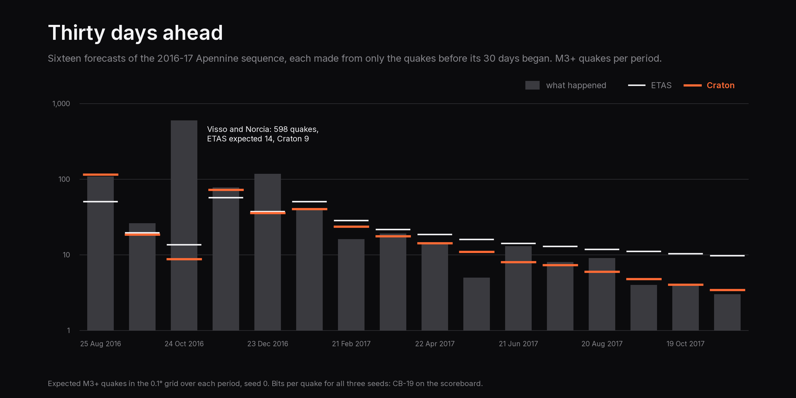
  </picture>
</p>

CB-19 asks CB-02's question a month at a time. ETAS wins it: Craton is **0.22 bits per quake behind**
(−6.226 against −6.002), behind on every seed. Without the months that hold an M5+ the two are level, and
Craton is closer in most quiet months. The loss is two surprises no earlier data foresaw: Norcia's 6.5, and
four M5s at Campotosto at the sequence's southern end.

GPS was the reason to try a month. Added to the Field it gains +0.13 bits per quake on every seed, all of it
in *how many*: most likely the stations measuring the big shocks and the slow slip after them. That's useful,
and it isn't a precursor. With those jumps removed, the gain stops being consistent (one seed up, two
down), so GPS stays out of the Fields until P10's instruments (D-105).

## One model, the whole Earth

<p align="center">
  <picture>
    <source media="(prefers-color-scheme: dark)" srcset="docs/assets/world-dark.png">
    <source media="(prefers-color-scheme: light)" srcset="docs/assets/world-light.png">
    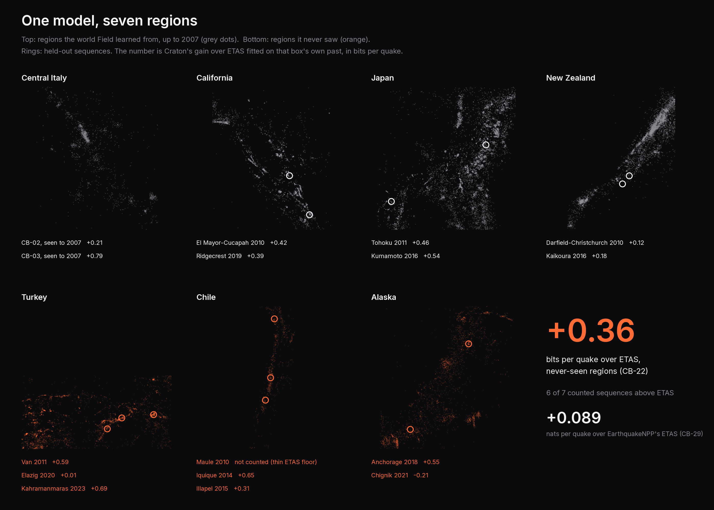
  </picture>
</p>

Everything above was central Italy. Then one Field learned from four regions at once (central Italy,
California, Japan, New Zealand, up to 2007) and was asked about places and years it never read. Each region is
a YAML file, and each speaks in its own magnitudes.

| | Craton over ETAS fitted there |
|---|---|
| Held-out sequences in the regions it learned from (Ridgecrest, Tohoku, Kumamoto, Kaikoura, ...) | **+0.35 bits per quake**, all six above ETAS |
| Regions it never saw a quake from (Turkey, Chile, Alaska) | **+0.36 bits per quake**, all three regions above ETAS |
| [EarthquakeNPP](https://arxiv.org/abs/2410.08226): their data, splits, ETAS and metric | **7.167 vs 7.256 nats per quake**, every seed |

EarthquakeNPP is someone else's exam: five neural forecasters lost to ETAS on it. Craton beats their ETAS by a
small, steady margin. Two honest catches. ETAS that knows networks go blind after big shocks is level with
Craton on the never-seen regions (+0.34), and wins Chile. And Maule 2010 isn't counted, because its box has too
few past quakes for ETAS itself to be fitted (D-091). That rule was written after seeing Maule, and with Maule
counted the never-seen half is below ETAS on every seed (−1.42 on average). So from now on the bar for
never-seen regions is ETAS-incomplete, not plain ETAS (D-093). Step by step: [`lessons/P8.md`](lessons/P8.md).

## What the network missed

<p align="center">
  <picture>
    <source media="(prefers-color-scheme: dark)" srcset="docs/assets/missed-dark.png">
    <source media="(prefers-color-scheme: light)" srcset="docs/assets/missed-light.png">
    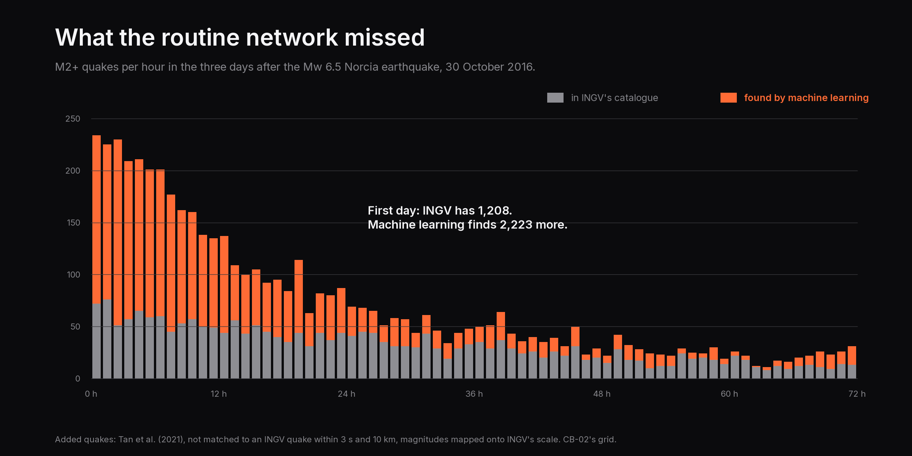
  </picture>
</p>

In Norcia's first day the routine catalogue holds 1,208 quakes above M2. Machine-learning catalogues,
built later from the same seismograms, find 2,223 more. CB-20 and CB-21 rerun CB-02 and CB-03 with those
extra quakes added to every forecaster's history. The days and scored quakes stay the same (D-094).

| bits per M3+ quake | ETAS | ETAS-incomplete | Craton |
|---|---|---|---|
| CB-02, 2016-17, INGV only | −7.118 | −7.059 | **−6.818** |
| CB-20, the same days, INGV + machine learning | −6.985 | −6.955 | −7.028 |
| CB-03, L'Aquila 2009, INGV only | −9.396 | −9.295 | **−8.233** |
| CB-21, the same days, INGV + machine learning | −9.360 | −9.260 | **−8.224** |

The better catalogue helps ETAS (+0.13 bits per quake on 2016). It hurts Craton, which falls below ETAS on
CB-20. The Field learned from INGV alone, and part of what it learned is that INGV misses quakes after a big
shock: it forecasts about 1.9 times ETAS's count. Fill those gaps in and it still multiplies, so it expects
1,560 M3+ quakes where 1,065 came. On L'Aquila the machine-learning catalogue adds few quakes, and Craton
stays 1.1 bits above ETAS. Part of Craton's edge on CB-02 turns out to be a learned fix for the catalogue's
gaps (D-096).

A curriculum fixes it: trained first on fake planets, each seen twice (once complete, once through a
network blinded by its big shocks), then on the world's regions, then on central Italy, the Field gains
+0.09 on CB-20 on every seed. It also loses 0.03 on CB-02, so the board keeps the Field that only knew
Italy (D-102).

## Where people pushed the crust

<p align="center">
  <picture>
    <source media="(prefers-color-scheme: dark)" srcset="docs/assets/pump-dark.png">
    <source media="(prefers-color-scheme: light)" srcset="docs/assets/pump-light.png">
    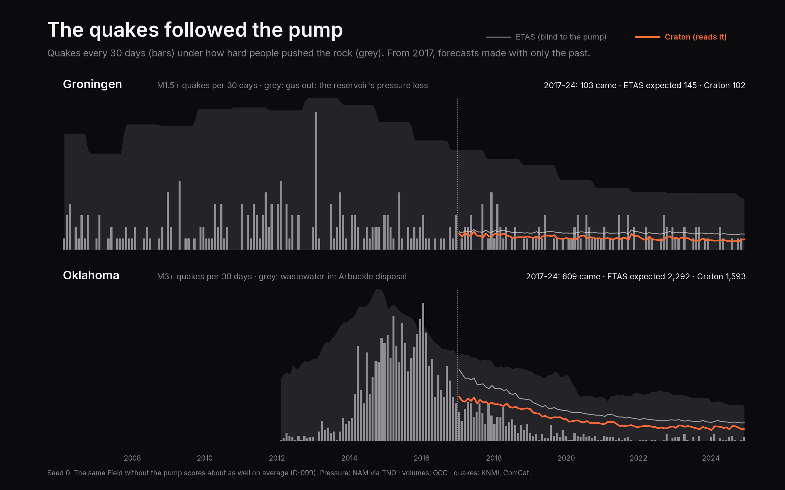
  </picture>
</p>

In two places the push behind the quakes is written down. Groningen's gas field has a map of its
reservoir's pressure every year; Oklahoma has every disposal well's volume every month. In both, people
turned the push down and the quakes fell. CB-30 forecasts both, 30 days at a time from 2017, with only the
past (D-099).

| bits per quake, 2017-24 | ETAS | physics floor | Craton without the pump | Craton |
|---|---|---|---|---|
| Groningen, M1.5+ | −10.553 | −10.517 | −10.213 | **−10.196** |
| Oklahoma, M3+ | −10.848 | −9.972 | −9.847 | **−9.791** |

Craton is **+0.71 bits per quake** above ETAS and above a physics floor whose background follows the pump,
on every seed. But the same Field trained without the pump is almost as good. The gain comes from reading
the quakes; the pump only makes it steadier from seed to seed. Craton hasn't learned "pressure → quakes" yet,
and the reason is in the training years: before 2017 nobody had turned the pump down hard, so there was no
cut to learn from.

## Which way the crust is squeezed

<p align="center">
  <picture>
    <source media="(prefers-color-scheme: dark)" srcset="docs/assets/squeeze-dark.png">
    <source media="(prefers-color-scheme: light)" srcset="docs/assets/squeeze-light.png">
    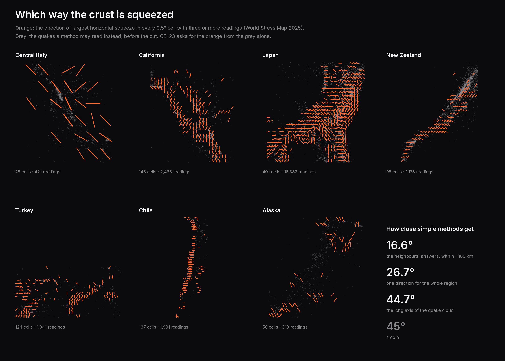
  </picture>
</p>

A model that understands the crust should know things about it nobody showed it. The first: which way
the rock is being squeezed. The World Stress Map has read that direction in 100,842 places, from how quakes
slipped, how boreholes break and how cracks open. CB-23 hides all of it and asks for the direction in 983
cells across seven regions, from the quake catalogue alone: where, when, how big, never how they slipped.

| degrees off (lower is better) | all seven regions |
|---|---|
| a coin | 45 |
| the long axis of the quake cloud (quakes only) | 44.7 |
| one direction per region (reads the other cells' answers) | 26.7 |
| the neighbouring cells' answers, within ~100 km | **16.6** |

Drawing a line through the quakes is worth nothing: the squeeze isn't written on the dots' shape. Craton's
answer arrives with its hidden-state layer (P9c). The bar is the neighbours' 16.6°, read from quakes alone.

## Where the sequence went next

<p align="center">
  <picture>
    <source media="(prefers-color-scheme: dark)" srcset="docs/assets/migration-dark.png">
    <source media="(prefers-color-scheme: light)" srcset="docs/assets/migration-light.png">
    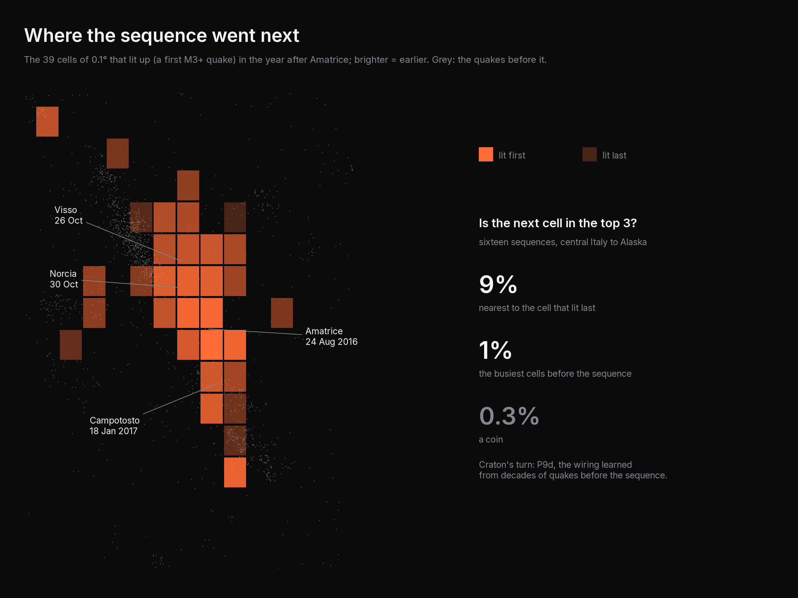
  </picture>
</p>

In 2016 central Italy didn't shake in one place. Amatrice went in August, Visso and Norcia 25-30 km north
in October, Campotosto to the south in January. CB-24 cuts sixteen sequences like it into 0.1° cells and
asks, before each new cell lights up, which dark cell is next. A method sees the decades before and the
cells lit so far, nothing else, so the question is how the faults are wired, never where aftershocks are
piling up.

| next cell in the top 3 | all sixteen | central Italy |
|---|---|---|
| a coin | 0.3% | |
| the busiest cells before the sequence | 1.4% | 5.3% |
| the cells nearest the one that lit last | **9.3%** | 14.5% |

The physics answer joins the board too: Coulomb stress with rate-and-state friction, built from the
catalogue alone. On the Apennines it scores −7.52 bits per quake, ETAS −7.12, Craton −6.82. Physics with
guessed fault geometry loses to plain statistics, the same thing Mancini et al. found in 2019 before they
fed it measured slip. Craton's turn on CB-24 is P9d, the wiring it learns from decades of quakes.

## The rule inside the network

<p align="center">
  <picture>
    <source media="(prefers-color-scheme: dark)" srcset="docs/assets/law-dark.png">
    <source media="(prefers-color-scheme: light)" srcset="docs/assets/law-light.png">
    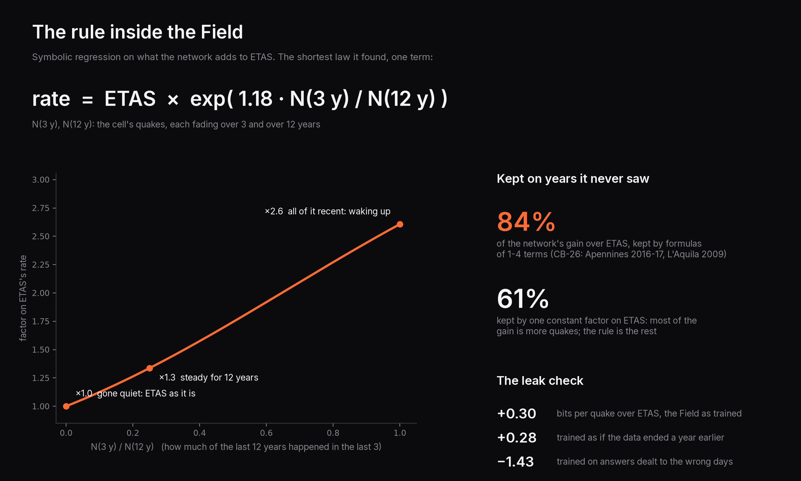
  </picture>
</p>

A network that beats ETAS could have learned something about quakes, or memorised central Italy. One way
to tell: squeeze it into a formula. If what it adds to ETAS is a rule, ten terms should hold most of it on
years neither ever saw. If it's memory, nothing short will.

Symbolic regression (PySR) searched formulas over the same fading quake counters the Field reads, fitted
to the Field's own corrections on the training years. The answers are short: two to four terms keep 89%
of its gain on the Apennines 2016-17, one or two keep 78% on L'Aquila 2009. That's CB-26, **0.84 ± 0.05**.

The floor is humbling, though. One constant, ETAS times 1.5 everywhere (2.1 for L'Aquila), keeps 61%:
most of what the Field adds on these two tests is that ETAS expects too few quakes inside a big
sequence. The formulas are the rest, and they're what holds on the quiet training years, where the
constant loses.
The shortest says: compare a cell's last 3 years with its last 12, and raise ETAS where the recent part
is bigger. All six formulas lower ETAS where the last 12 years were busy, which fits a known flaw: ETAS
takes the long tails of old sequences for background (van der Elst, 2017).

Before trusting any of it, the leak check. Trained as if the data ended a year earlier, the gain is
nearly the same (+0.28 against +0.30, two seeds). Trained on the right inputs with every day's answers
dealt to a different day, it falls to −1.43 bits per quake, far below ETAS: without time, the network
learns the wrong lesson. The gain reads time.

## A crust nobody can see

<p align="center">
  <picture>
    <source media="(prefers-color-scheme: dark)" srcset="docs/assets/planted-dark.png">
    <source media="(prefers-color-scheme: light)" srcset="docs/assets/planted-light.png">
    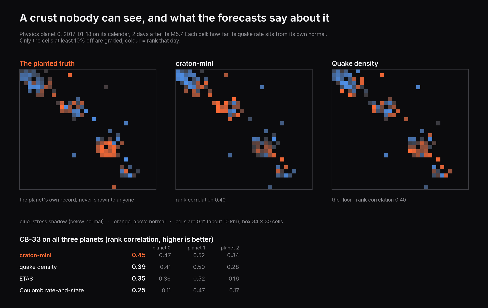
  </picture>
</p>

Every claim so far about what the network "knows" about the crust is about a crust nobody can measure.
The physics planets (CB-09) can: they're built from rate-and-state friction, so every fault patch has a
state that says how far its quake rate sits from normal, and the planet writes it down. CB-33 asks a
forecast to rank the cells by that hidden state, on days it never saw: a stress meter, graded against
the stress.

craton-mini ranks them at **0.45 ± 0.09** (rank correlation, three planets). The floor, a cell's last
year of quakes over its long-run rate, gets 0.39; ETAS 0.35; Coulomb rate-and-state, which computes
stress from the quakes' slip, 0.25. So the forecast does carry a picture of the crust's state, a bit
better than the obvious one, and far from perfect. Through the map referee (below), the lead over the
floor holds on two planets of three: on planet 1 it flips sign between two halves of the cells.

The obvious next move was to force it. Dieterich (1994) showed that seismicity *is* a stress meter: one
stress history moves the rate of every magnitude alike, and quakes use up the faults that made them.
A version of the Field whose only output is a stress, with rates coming through that law exactly, lost
everywhere: −0.29 bits per quake on the Apennines, −0.74 on L'Aquila, and 0.41 on CB-33 against
mini's 0.45, even on planets built from the same law. Most of the loss is the using-up: the data
doesn't want a busy cell to go quiet on a five-to-eight-year clock. The one part that paid was the
shared stress, which sharpened *where* by a little on every run. Not kept; mini is unchanged.

## A paper from 2010 already had half of it

<p align="center">
  <picture>
    <source media="(prefers-color-scheme: dark)" srcset="docs/assets/local-alpha-dark.png">
    <source media="(prefers-color-scheme: light)" srcset="docs/assets/local-alpha-light.png">
    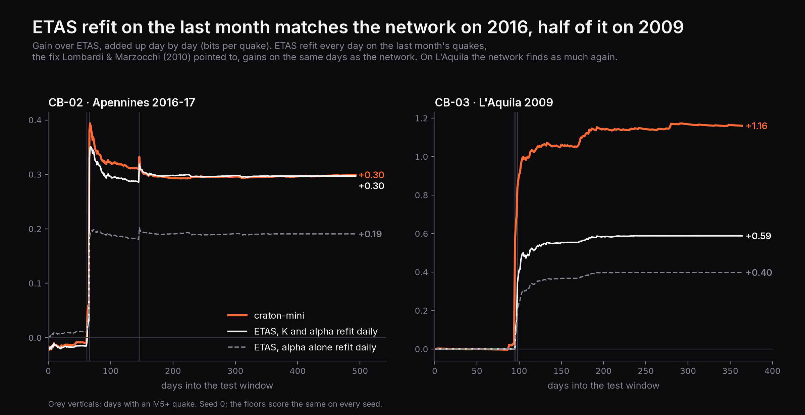
  </picture>
</p>

INGV's own daily ETAS for Italy (Lombardi & Marzocchi, 2010) undershot the start of the 2009 L'Aquila
sequence, and the authors said why: one number of the model is local. α, how much faster a bigger
quake's aftershock count grows, is 1.3 for Italy and 1.5 to 2.0 inside that sequence. The formulas
above said the same thing from the other side: ETAS expects too few quakes inside a big sequence.

So the obvious floor: ETAS that refits its productivity (K and α) every day on the last month's quakes,
nothing else touched (`etas_local_alpha`). On the Apennines 2016-17 it scores **+0.30 bits per quake
over ETAS, exactly craton-mini's +0.30**, gaining on the same days (day-by-day correlation 0.99). On
L'Aquila it gets +0.59, and the network +1.16: as much again, 0.15 of it in *where*, which a refit of
productivity can't touch. Refitting α alone lands at 1.5 and 1.7 on the busy days, the paper's range.

So, plainly: on one of our two held-out sequences, everything the Field adds is a thirty-day refit of
two numbers. On the other it adds something more, and that something is now the thing to explain.

## The quakes know where the gas field drained, not where it drains now

<p align="center">
  <picture>
    <source media="(prefers-color-scheme: dark)" srcset="docs/assets/pressure-dark.png">
    <source media="(prefers-color-scheme: light)" srcset="docs/assets/pressure-light.png">
    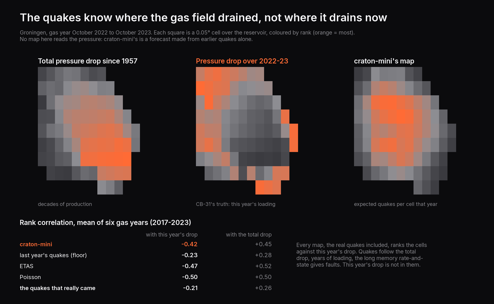
  </picture>
</p>

Groningen has the one hidden state somebody measured: the gas pressure 3 km down, mapped every year.
CB-31 asks a model that never reads it (it answers through a view that refuses those files) to forecast
the quakes of 2017-2023, and grades its map against where the pressure fell that year.

Every map fails, and in the same direction. craton-mini ranks the cells at **−0.42**, ETAS −0.47, last
year's quakes −0.23. Even the quakes that really came, used as their own forecast, score −0.21. After
production was cut, the drained centre stopped falling and began to refill while the edges kept
draining; the quakes stayed in the centre. Against the *total* drop since 1957 every map is positive
(ETAS +0.52, mini +0.45).

That fits rate-and-state: a fault's quake rate remembers years of loading, so it follows the total,
and a single year's change barely shows. No model can read from the quakes what the quakes don't
carry. The test stays on the board, frozen, as the number to beat when other data comes in.

## A region it never read

<p align="center">
  <picture>
    <source media="(prefers-color-scheme: dark)" srcset="docs/assets/unseen-regions-dark.png">
    <source media="(prefers-color-scheme: light)" srcset="docs/assets/unseen-regions-light.png">
    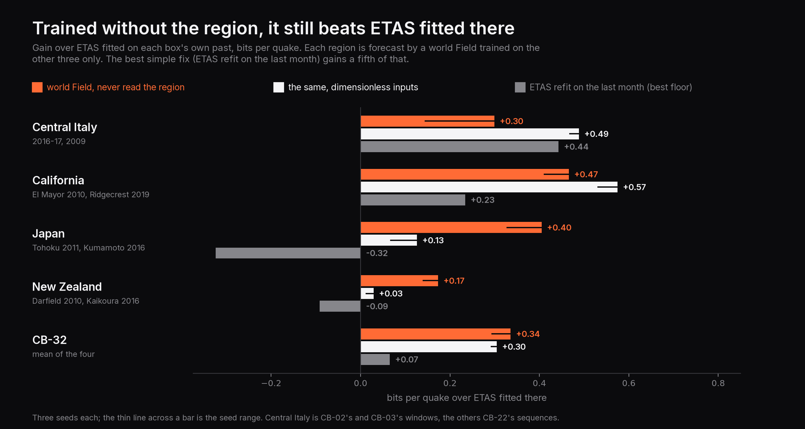
  </picture>
</p>

Hydrologists call it prediction in ungauged basins: train a model on hundreds of rivers, then
forecast one it never saw ([Kratzert et al. 2019](https://doi.org/10.1029/2019WR026065)). CB-32 asks
the same of the crust. The world Field is trained four times, each time without one of its regions
(central Italy, California, Japan, New Zealand), and scored on that region's sequences against ETAS
fitted on the region's own past.

It wins in all four, on every sequence and every seed: **+0.34** bits per quake on average, against
+0.07 for the best simple fix (ETAS refit on the last month). Leaving a region out costs almost
nothing in California and New Zealand and about a tenth of a bit in Japan. Central Italy is where its
own past matters: there the refit floor does better (+0.44), on 2016-17 and on L'Aquila 2009.

The obvious next step was to strip the units, so every region looks alike: counters over what ETAS
expects, time in units of each box's Omori clock, distance in rupture lengths
([Wells & Coppersmith 1994](https://doi.org/10.1785/BSSA0840040974)). It made central Italy and
California better on every seed and Japan and New Zealand worse on every seed, and lost on the mean
(+0.30). The units were carrying something the network used. The model keeps reading them (D-131).

## The squeeze, from how quakes slipped

<p align="center">
  <picture>
    <source media="(prefers-color-scheme: dark)" srcset="docs/assets/mechanisms-dark.png">
    <source media="(prefers-color-scheme: light)" srcset="docs/assets/mechanisms-light.png">
    
  </picture>
</p>

Where quakes happen can't tell you which way the crust is squeezed: a line of quakes runs along the
squeeze on a normal fault and across it on a thrust (CB-23 sat at a coin's 45°). *How* they slipped can.
Every big quake since 1976 has a moment tensor in the [Global CMT](https://www.globalcmt.org) catalogue,
56,832 of them, and its pressure axis points roughly along the squeeze. They're Craton tokens now
(Token Spec 1.3.0, one more instrument, nothing changed).

The exam can't grade a mechanism reader on mechanisms, and most of the World Stress Map is mechanisms.
So CB-34 keeps only stress that nobody read from a quake: boreholes that went oval, fractures from
drilling and from pumping water in, fault scratches.

Craton answers with a **tensor field**, BERT's game for slip: hide one mechanism, predict it from its
48 neighbours, with each training example spun about the vertical so no region's direction can be
memorised. It never sees a stress record, or Turkey, Chile and Alaska. **31.3°** off, against 33.4° for
the textbook sum of the same tensors (Kostrov 1974, with
[Lund & Townend 2007](https://doi.org/10.1111/j.1365-246X.2007.03468.x)), and 26° in Chile against
the textbook's 38°. Copying the neighbouring boreholes' own answers still wins (27.9°). That reads the
answers, and a borehole is a long drive from most quakes.

## Every map, refereed

In 2026-10 a tidal "discovery" died when a plain 24-hour clock matched it just as well (`craton
referee`). Maps fool you the same way. Any smooth map agrees a bit with any other, and a map that only
knows the regional average looks right wherever the average is. So every map shown here goes through
four tests (`craton/trust/maps.py`): beat a coin, beat the floor, beat 95% of 200 copies of itself slid
around the region (same texture, alignment broken), and keep its lead on half the cells after the
other half's lead is written down and hashed.

| Map | Claim | Verdict |
|---|---|---|
| CB-23, the squeeze | copying neighbours knows more than one direction per region | passes |
| CB-34, the squeeze from mechanisms | the tensor field beats the Kostrov sum | passes, three seeds |
| CB-33, a crust nobody can see | craton-mini ranks the planet's state better than quake density | two planets of three |
| CB-31, Groningen | craton-mini's map follows the year's pressure drop | fails everything (as stated above) |

## One day each

Score the Italian forecasts day by day and the gains have an address. Drop 30 October 2016, the Norcia
day with a quarter of the sequence's quakes, and craton-mini falls to **−0.02** bits per quake against
ETAS: the whole Apennine gain is one day. Drop 6 April 2009 and it keeps +0.89 on L'Aquila, but its
lead over ETAS refit daily shrinks from +0.58 to +0.09. On that night every one of the Field's six
members sat at its ×4 limit in the epicentral cell, while INGV's published gains were 5 to 25×.

So we let it go to ×16. It won the L'Aquila night (+0.18 bits per quake for the whole task) and lost
more than that on every other day (−0.29), overshooting the calmer days after. The limit is a brake,
and it stays (D-136). Telling the big night from the rest is a measurement the plan takes check-first, in P15.

## Built like a building

You don't redesign the foundation every time you add a floor. Craton is constructive-only:

- **The token spec is frozen once released.** New versions may only *add* fields and instruments. Data written
  in 2026 stays valid forever.
- **Data is immutable.** Every download and token file is content-hashed; corrections arrive as new versions.
- **Benchmarks are immutable.** A test's data and metric never change. A better test gets a new ID.
- **The ratchet.** A change lands only if no benchmark gets worse beyond noise (2σ over 3 seeds), compared
  with the best score ever recorded, so small losses can't quietly stack up.
- **Every number comes from a script.** `SCOREBOARD.md` is generated; the check fails if a human edits it.
- **The logbook and decisions are append-only.** Mistakes get corrected below, never erased.

All of it is one command, the same on a laptop and on CI:

```console
$ uv run craton check
✓ lint · ✓ format · ✓ types · ✓ tests · ✓ scoreboard is generated · ✓ records append-only
✓ locked forecasts sealed, never edited · ✓ benchmarks frozen, no leaks · ✓ ratchet
all green. The foundation holds.
```

## One codebase, three sizes

The only difference between them is a YAML file in [`configs/`](configs/).

| | Trunk | Shape | Context | Where |
|---|---|---|---|---|
| **Craton-mini** | 4.74M | d=256 × 6 layers | 1,024 tokens | a laptop RTX 2060, 6 GB, central Italy |
| **Craton-regional** | 85.1M | d=768 × 12 layers | 8,192 tokens | one rented A100 |
| **Craton-planet** | 1.61B | d=2048 × 32 layers | 131,072 tokens | a GPU cluster, once the scaling law says so |

Parameter counts come from `craton config <size>`, and a config that lies about its own size fails to load.

## Roadmap

```
CORE       ██████████████████████████████   8/8    foundation → beat ETAS → a model that knows when it doesn't know
DISCOVERY  ██████████████████████████████   3/3    other planets, hidden state, listening
FIELD 2    ░░░░░░░░░░░░░░░░░░░░░░░░░░░░░░   0/6    a transformer shaped for the Earth, judged on the whole world
```

| | Phase | Borrowed from the LLM world |
|---|---|---|
| ✅ | **P0** Foundation: repo, checks, the ratchet | the training-infra repo every lab builds first |
| ✅ | **P1** The universal token, frozen | the tokenizer |
| ✅ | **P2** First data: INGV catalogue, GNSS, tides | the data pipeline |
| ✅ | **P3** CratonBench + baselines, before any model | the eval harness |
| ✅ | **P4** Craton-mini v0, the first transformer | the GPT-2 small run |
| ✅ | **P5** Fusion: quakes + GPS + the Moon | multimodal models |
| ✅ | **P6** Beat ETAS: the Field | state-space memory, residual learning, ensembles |
| ✅ | **P7** The 8 locks: knowing when it doesn't know | calibration, ensembles, red-teaming |
| ✅ | **P8** Other planets: the world's sequences, Groningen, Oklahoma, fake planets | more pretraining data, synthetic data |
| ✅ | **P9** The hidden state: stress and pressure nobody measures, graded against data it never saw (stress from quakes CB-23 and from mechanisms CB-34, migration CB-24, the distilled law CB-26, planted stress CB-33, Groningen pressure CB-31, regions it never read CB-32; five blocks built and not kept; a referee for maps) | latent variables, probing, masked modelling |
| ✅ | **P10** Listening: the crust's continuous hum as two new instruments (noise power, dv/v, CB-28); at the 2016 shocks the hum's speed stayed inside its own wobble, and neither our ear nor a borrowed one (SeisLM) helped the Field | a new modality |
| ◻️ | **P11** The viable test: the smallest real Field 2, born equal to ETAS, trained on the world | relative position encodings, the tiny first run |
| ◻️ | **P12** The heart and the fair judge: a world gate with a sealed vault, and the growth curve | the eval harness, scaling laws |
| ◻️ | **P13** The places: every patch of crust carries a hidden state, quakes write into it | latent state tokens, masked modelling, in-context learning |
| ◻️ | **P14** What pushes the places: plate charging, what the rock is, the faults between them | conditioning, graph attention |
| ◻️ | **P15** Understanding and the equation: what it learned, read out as one formula | auxiliary objectives, test-time sampling, distillation |
| ◻️ | **P16** Grow and ship: weights, a live demo, an open leaderboard, 1.0.0 | model hubs, leaderboards |

The full plan, with every benchmark and exit test: [`ROADMAP.md`](ROADMAP.md).

## Quickstart

```console
git clone https://github.com/AhmedHeshamEG/craton && cd craton
uv sync --extra cu126      # NVIDIA GPU   (no NVIDIA: uv sync --extra cpu)
uv run craton doctor       # what this machine can run, and how
uv run craton check        # everything that has to pass before a change lands
uv run craton spec example montecassino_1349   # the monk's diary, as a token
```

With the data built (`craton data fetch central_italy`, `craton data build central_italy`,
`craton bench prepare`), train and score the first model:

```console
uv run craton train cb03_fit --seeds 0    # one model, its checkpoint and model card
uv run craton bench run craton-mini       # all three seeds on every task it supports
```

On the laptop it was built on, `craton doctor --smoke` says:

```console
machine  Windows 11 · Python 3.11.9 · 15.8 GiB RAM
pytorch  2.14.1+cu126 (CUDA 12.6)
gpu      NVIDIA GeForce RTX 2060 · 6 GiB · Turing sm_75
fp16     ✓ tensor cores · trains with gradient scaling
bf16     ✗ not on Turing · a bf16 request becomes fp16

 size       status    trunk   d × layers   context   precision here
 mini       active    4.74M   256 × 6      1,024     fp16 + scaler
 regional   planned   85.1M   768 × 12     8,192     bf16 → fp16 + scaler
 planet     planned   1.61B   2048 × 32    131,072   bf16 → fp16 + scaler

✓ smoke: 60 fp16 steps on cuda · loss 0.522 → 0.001 · peak 17.4 MiB
ready: Craton-mini trains on this GPU.
```

Needs [uv](https://docs.astral.sh/uv/) and Python 3.11+.

## Learn along

Every phase ships a lesson in [`lessons/`](lessons/), written for a smart friend who has never trained a model:
the idea step by step, the LLM analogy and where it breaks, the code in the order data flows, and a few
commands to run it yourself. Follow the phases and you've built a foundation model from an empty folder.

## Contributing

Adapters for new data, new forces, new benchmarks: everything plugs in through registries, nothing edits the
core, and the ratchet guards the rest. Start with [`CONTRIBUTING.md`](CONTRIBUTING.md).

## Credits

Hero data: [USGS ComCat](https://earthquake.usgs.gov/earthquakes/search/) (public domain), drawn by
[`scripts/figures/banner.py`](scripts/figures/banner.py). Central Italy: [INGV ISIDe](https://doi.org/10.13127/ISIDE)
(CC-BY-4.0) and the [Nevada Geodetic Laboratory](https://geodesy.unr.edu/) (Blewitt et al. 2018); the tide
follows the IERS Conventions (2010). Type: [Inter](https://rsms.me/inter/) (SIL OFL).
Groningen: [KNMI](https://rdsa.knmi.nl/) (CC-BY-4.0) and NAM's reservoir model ([TNO 2023](https://doi.org/10.5281/zenodo.10245813)).
The local-alpha floor follows [Lombardi & Marzocchi (2010)](https://doi.org/10.4401/ag-4848), INGV's
daily ETAS for Italy. Rupture lengths: [Wells & Coppersmith (1994)](https://doi.org/10.1785/BSSA0840040974).
Leave-one-region-out follows [Kratzert et al. (2019)](https://doi.org/10.1029/2019WR026065).
Moment tensors: the [Global CMT Project](https://www.globalcmt.org) (Dziewonski et al. 1981; Ekström
et al. 2012); stress records: the [World Stress Map 2025](https://doi.org/10.5880/WSM.2025.001) (CC BY 4.0).
Craton stands on SeisLM, ETAS, CSEP and pyCSEP, GraphCast's lesson about reanalysis, and decades of open
catalogues from INGV and the Nevada Geodetic Laboratory. Full sources per phase in the lessons.

## Citing

See [`CITATION.cff`](CITATION.cff), or GitHub's "Cite this repository" button.

## License

Code: [Apache-2.0](LICENSE). Every dataset keeps its own licence, recorded in its data card.

<sub>A craton is the ancient core of a continent: rock that hasn't deformed in billions of years, while new crust
keeps docking onto its edges. That's the rule for this repo.</sub>
