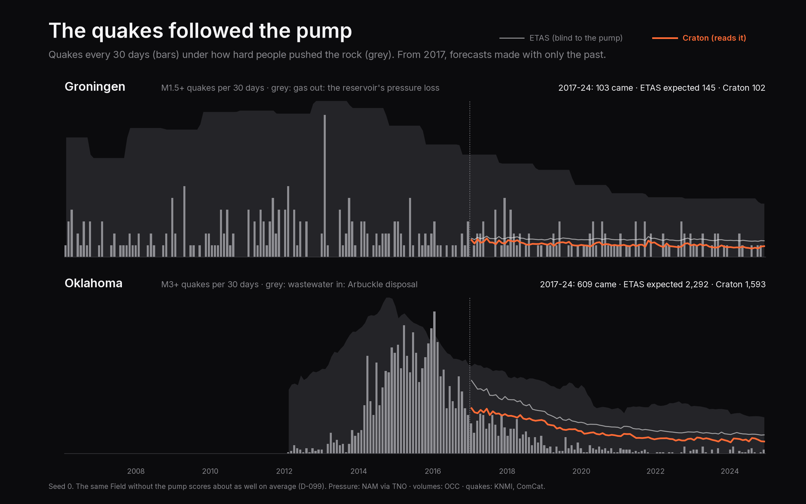

# P8 — Other planets: real, human-made and fake

P8 comes in six parts (D-078). This file grows one part at a time, in the order they ship.

## P8a — Two fake planets

### TLDR

Central Italy has three big sequences in forty years. Any score built on three is part luck, and
there's no way to tell which part. So P8 starts by building planets where the answer is known.

On the **ETAS planet**, quakes follow ETAS with Italy's own fitted numbers, so ETAS is the whole
truth and nothing can beat it on average. Craton should only tie. It does: 0.02 bits per quake below
fitted ETAS, 0.002 below the truth itself.

On the **physics planet**, quakes come from a different machine: faults loaded slowly, stress
passed from quake to quake (up off a rupture's ends, *down* beside it), and a fluid source nobody
sees. ETAS is the wrong model there, and Craton, trained on it exactly as it trains on Italy, beats
ETAS by **0.19 bits per quake**. All of the gain is in *where*. That's a real
win, but a fifth of the +1 the roadmap hoped for.

Both planets also say how far they are from the real Apennines, and both are a long way off. The
real quakes come in tight bursts: the busiest 1% of days hold 31% of them. On either planet it's
5-10%.

### The idea, step by step

**1. Why fake planets.** Score a forecaster on Italy and you learn how it did on Italy's 2009 and
2016. You never learn what it *could* have done, because nobody knows the true process. On a
simulated planet you do. If the truth is ETAS, the best possible forecast is ETAS with the true
numbers, and you can measure how close anyone gets. If the truth is something ETAS can't express,
you can check whether a learner finds it. This is the same reason language models are trained and
tested on synthetic tasks with checkable answers.

**2. The ETAS planet.** CB-02's ETAS floor, fitted on central Italy from 2005 to the day before
Amatrice, gives eight numbers. They cover:

- the background rate,
- how many aftershocks a quake of each size makes,
- how fast those aftershocks fade (Omori's law, `p = 1.19`),
- how far away they land.

Simulate a planet with exactly those numbers and Gutenberg-Richter's `b = 1.16`. On it, the
best forecast is ETAS with those same numbers, and that's the line no forecaster can beat on
average (D-080).

**3. The physics planet.** The plan was QDYN, a rate-and-state earthquake-cycle code. That failed
twice over:

- QDYN is Fortran, and this laptop has no Fortran compiler.
- It answers a different question: one fault's cycle in detail, where a forecaster needs a region's
  catalogue full of aftershocks of aftershocks.

So the physics planet works one level up, the way the seismicity literature does (D-079).

- **Patches that fail.** About 1,500 small patches. Each one fails at a background rate *r* while
  the crust loads it at a steady stressing rate.
- **Dieterich's law** (1994) says how a patch's rate reacts when its stress jumps by ΔS. The rate
  multiplies by `e^(ΔS/Aσ)`, then relaxes back to *r* over a time `ta = Aσ / stressing rate`.
  - That relaxation is Omori's law. You don't put it in; it comes out.
  - A drop in stress does the opposite: the rate falls *below* background, a **stress shadow**,
    and only recovers over years.
- **Stress transfer.** Every quake from M2.5 changes the stress on every patch:
  - up off the rupture's ends,
  - down beside it and on it,
  - falling off as distance cubed, with a random kick per patch so the lobes aren't perfect.
- **Faults.** Thirty-six normal faults run along an Apennine-shaped line. Each fault's largest
  quake comes from its length (Wells & Coppersmith: a 17 km fault tops out near M6.5).
- **Fluid.** One or two hidden fluid sources push pore pressure outward like heat, as
  `erfc(r / √(4Dt))`, for a few years. Pressure lowers the friction that holds faults shut, so rates
  climb near the source.

The integrator is exact. Between quakes, each patch's state follows the loading law in closed form,
and each step's expected count is the exact integral of the rate. The tests check it against
Dieterich's own formula from one minute to a century, for steps up and down.

**4. Where ETAS is wrong there.** ETAS has no shadows (its rates never go below background). Its
aftershocks spread in a circle, not along faults. It has no hidden pressure. And on this planet
small quakes trigger almost nothing, because their stress 2 km away is a few kilopascals. ETAS
says every quake triggers in proportion to `e^(α·M)`. A model that learns from data should find
some of this.

**5. CB-09: CB-02's calendar on six frozen planets.** Each planet copies CB-02 exactly (D-081):

- quakes from 1985;
- training on everything before 24 August 2016;
- a forecast every day from 25 August 2016 to the end of 2017;
- the same 0.1° grid, scored by the same function.

Only planets whose test window holds a sequence count: an M5+ and at least 100 M3+ quakes. That
gives three of each kind, written once, hashed and frozen. Seed *k* is planet *k*, so the ± over
three seeds is mostly planet-to-planet luck. ETAS and the Field run unchanged. A planet answers
the same calls a region does.

**6. A bug caught by the gap table.** The first freeze gave the ETAS planet `b = 1.02`, where its
truth is 1.16. A real catalogue's "M2.0" means everything from 1.95 up to 2.05. The simulator
started at exactly 2.0 and rounded, so the first bin came out half empty and the slope flattened.
Planets now start half a step below their smallest magnitude, and the record was re-frozen before
anything was committed.

**7. The sim-to-real gap.** How far is each planet from the real Apennines? D-082 takes five
numbers every catalogue has:

- quakes per day,
- b-value,
- the share of quakes on the busiest 1% of days,
- the share in the busiest 5% of cells,
- the spread of daily counts.

The gap is the average factor off, in doublings: 0 means identical on these five, 1 means off by
2× on average.

### The LLM analogy

- **Synthetic data with a checkable answer.** The ETAS planet is a task whose optimum is known, like
  arithmetic generated for a model whose answers you can check. A learner that *beats* the optimum
  there is leaking or overfitting.
- **Distribution shift, sim to real.** The physics planet is the "simulated world". Its gap to
  reality is the reason a model pretrained on it still has to be fine-tuned on the real thing
  (P8f).
- Where it breaks: an LLM's synthetic data is cheap and endless. Here each planet costs 2 minutes
  to simulate and 2 hours to train on.

### What the code does

1. `craton/sim/rate_state.py`: the physics planet. Patches, stress steps, fluid pressure, the exact
   Dieterich integrator and event sampler.
2. `craton/sim/__init__.py`: `etas_italy`, the ETAS planet. Both planets are registered in the
   simulator registry P7 left ready.
3. `craton/bench/planets.py`: CB-09. `PlanetContext` lets any forecaster run on a planet. The
   module also holds planet choice and freezing, the truth forecast, the gap statistics and
   scoring.
4. `scripts/figures/planets.py`: the figure.
5. `tests/test_sim.py`, `tests/test_planets.py`.

### The numbers

Mean of 3 seeds (= 3 planets of each kind). Bits per M3+ quake, higher is better.

| | Craton | ETAS (fitted) | ETAS with the true numbers |
|---|---|---|---|
| **ETAS planet** | −14.146 | −14.124 | −14.143 |
| **Physics planet** | **−14.377 ± 0.43** | −14.571 | · (there's no ETAS truth) |
| … *where* bits on the physics planet | −7.362 | −7.554 | |
| … Craton minus ETAS, planet by planet | +0.165, +0.220, +0.195 | | |

The ± is the spread between planets: some planets are simply harder to forecast. Planet by planet,
Craton's lead moves by only ±0.03.

Sim-to-real gap, in doublings off the real Apennines: the ETAS planets 1.32, the physics planets 0.88.

In plain words:

- **The tie holds.** On the planet where ETAS is the truth, Craton lands 0.02 bits below
  fitted ETAS, inside the 0.05 the phase allows. Fitted ETAS itself scores slightly *above* the
  truth on all three planets (+0.02 on average). Over a single 16-month window the truth is the best
  forecast only on average, and that's the size of one window's luck.
- **The win is real and small.** +0.19 bits per quake on the physics planet. All of it is in
  where the quakes land; the count and the sizes are level with ETAS. Craton learns some of the
  fault map, the shadows and the fluid source, and nowhere near all. That points straight at P9,
  which asks the model for the hidden stress and pressure directly. The planet is also an easy one
  for a map of the past: Poisson is only 0.16 bits behind ETAS there (2.6 on the ETAS planet),
  because its small quakes trigger almost nothing. The room for a win was smaller than planned.
- **Both planets are too smooth.** The real Apennines put 31% of their quakes on the busiest 1% of
  days. The ETAS planet puts 5% there, the physics planet 10%. The physics planet is closer to Italy
  on the five numbers (0.88 doublings off against 1.32), but neither makes sequences as violent as
  the real ones. That's the planets' gap, and pretraining on them (P8f) has to survive it.

### Try it yourself

```console
$ uv run craton bench prepare --tasks CB-09          # the six planets and the gap table
$ uv run craton bench run etas --tasks CB-09 --seeds 0
$ uv run --group figures python scripts/figures/planets.py
```

### Check yourself

<details><summary>1. Why can't Craton beat ETAS on the ETAS planet, and why is a tie still a test?</summary>

Because there, ETAS with the true numbers *is* the process, and no forecast does better on average.
A tie shows the learner reaches the optimum when there is one. A clear win would mean it's reading
something it shouldn't, like the test window.
</details>

<details><summary>2. Where does Omori's law come from on the physics planet?</summary>

From Dieterich's law. A stress jump multiplies a patch's rate, and the rate relaxes back over
`ta = Aσ / stressing rate`. Integrate that over a population of patches and the rate decays as
about 1/t until `ta`: Omori with p ≈ 1, without ever being written in.
</details>

<details><summary>3. What is a stress shadow, and why can't ETAS make one?</summary>

A drop in stress beside a rupture. Patches there fail *less* often than before, for years. ETAS adds
aftershock rates on top of a background and never subtracts, so its rate can't fall below the
background.
</details>

<details><summary>4. Why simulate magnitudes from half a step below M2.0?</summary>

A catalogue's M2.0 is every quake from 1.95 to 2.05. Start at exactly 2.0 and round, and the 2.0
bin gets only half its quakes, which flattens the b-value (1.02 instead of 1.16).
</details>

## P8b — Thirty days ahead

### TLDR

CB-19 asks the CB-02 question one month at a time: from the quakes before a 30-day period
starts, how many M3+ quakes will it hold, and where? Sixteen periods cover the 2016-17 Apennine
sequence.

ETAS wins it. The Field, trained exactly as for CB-02 but answering 30 days at once, lands
**0.22 bits per quake behind** ETAS (−6.226 against −6.002). It is level with ETAS once the
months holding an M5+ are left out, and it is better on most quiet months. Almost all of the loss
sits in two months: the one holding Visso and Norcia, and the one holding the four Campotosto
M5s, at the sequence's southern end.

GPS was supposed to be the reason to look at 30 days. Added to the Field, it helps on every seed,
by +0.13 bits per quake, all of it in *how many*. That's most likely the stations measuring the
big shocks and the slow slip after them. That's real information, but it isn't a warning sign.

### The idea, step by step

**1. Why a month.** A daily forecast is mostly about aftershocks of yesterday's quakes. Over a
month, slower things have time to matter: a fault creeping, fluids moving, the crust relaxing
after a big shock. Those are what GPS can see. So the plan picked 30 days as the horizon where
GPS has its best chance.

**2. The task.** CB-19 copies CB-02: the same sequence, the same 0.1° grid, ETAS fitted on the
same years before Amatrice, the same score. The only change is the period. One forecast per 30
days from 25 August 2016, sixteen of them to mid-December 2017. The last 14 days hold one M3+
quake and are left out rather than scored as a short month (D-083).

**3. ETAS over a month.** For one day, ETAS adds up each past quake's Omori tail over the next 24
hours, plus the background, then multiplies by a cascade factor for the aftershocks of aftershocks
that the day itself will make. For thirty days it does the same over thirty days. The direct part
of a month is exactly its thirty days added up; a test checks that. The cascade factor grows,
because a month leaves more time for aftershocks to have aftershocks.

**4. The Field over a month.** The Field starts from ETAS and learns a per-cell correction. For
CB-19 it starts from ETAS's 30-day forecast, and every training midnight is checked against the
next 30 days' quakes. Two details keep it honest (D-084):

- the 30-day counts for 9,338 midnights come from one running sum, not 9,338 loops;
- a training midnight whose 30 days reach into a validation block is dropped, so no member trains
  on the quakes it is judged on.

**5. Where it wins and where it loses.** Month by month (seed 0), the Field is ahead on 7 of the
16 and behind on 9, and the gaps are wildly unequal:

- **Norcia's month** (24 October to 23 November): 598 M3+ quakes. ETAS expected 14, the Field 9.
  Nothing in the quakes before 24 October says a 6.5 is coming. The Field's map was much better
  (+263 bits on *where*), but its smaller count cost more, and it lost 103 bits overall.
- **Campotosto's month** (late December to late January): four M5s on 18 January, on the
  sequence's southern end, away from where the autumn's quakes had been. The Field had
  concentrated its map on the active faults even more than ETAS did, and lost 144 bits on *where*.
- **The quiet months of 2017**: the sequence fades, and ETAS keeps expecting 10-20 quakes a
  month when 3-13 come. The Field expects fewer and is closer.

Leave out the months with an M5+ and the two are level: −4.27 for the Field, −4.25 for ETAS.

**6. GPS.** About 260 GNSS stations, CB-04's held-out ones excluded. For every midnight and
station: how far it moved over the last 30 days beyond its own one-year trend. Per cell, a 25 km
weighted average of the nearby stations gives three numbers: horizontal motion, vertical motion,
and how well the cell is covered. They join the Field's memory. Nothing else changes (D-085).

It helps on every seed: +0.06, +0.22, +0.11. All of it goes to *how many*; *where* gets slightly
worse. The likeliest reading: a 30-day window that holds a big quake holds its jump in the
stations, and the afterslip that keeps moving them for weeks. Afterslip drives aftershocks, so
that's a fair thing to learn from. It is the sequence seen by a second instrument, though. It says
nothing about a quake before it happens.

**7. Why GPS waits.** Adding three features changes the Field's configuration, and every Field
checkpoint (CB-02, CB-03, CB-09) would retrain and move. P8f retrains them all anyway, on the
planets and the world's sequences, so GPS joins there, next to a version with the coseismic jumps
taken out. That version is what can tell afterslip from a precursor.

### The LLM analogy

- **Longer horizons, harder targets.** Predicting the next token is easier than predicting the
  next paragraph's topic: the further out, the more the answer depends on things the context
  doesn't hold yet. A month ahead, the next big quake is that kind of thing.
- **A second modality that mostly repeats the first.** GPS here is like adding captions to a text
  model when the captions mostly restate the text. It helps, but measure what it adds beyond what
  the model already reads before calling it a new sense.
- Where it breaks: an LLM sees billions of paragraphs. CB-19 is sixteen months, and three of them
  decide the score.

### What the code does

1. `craton/bench/tasks.py`: `ForecastSpec.period_days`, the score reading each quake into its
   period, and CB-19 itself.
2. `craton/bench/etas.py`, `craton/field/base.py`: ETAS's forecast over any span, on the CPU and
   on the GPU.
3. `craton/field/forecaster.py`: 30-day answers by a running sum, and dropping training starts
   that would see a validation block.
4. `craton/bench/baselines.py`, `craton/train/method.py`: `long_periods`, which says who can
   forecast more than a day (ETAS, Poisson, the Field; not ETAS-incomplete, whose blind time is
   counted in minutes inside one day).
5. `scripts/ablations/gps_thirty_days.py`: the GPS ablation. `scripts/figures/thirty_days.py`: the
   figure. `tests/test_horizon.py`.

### The numbers

Mean of 3 seeds. Bits per M3+ quake, higher is better. ETAS and Poisson give the same number on
every seed.

| | CB-19 | how many | where | months without an M5+ |
|---|---|---|---|---|
| Poisson | −10.517 | −4.255 | −8.051 | −9.779 |
| **ETAS** | **−6.002** | −2.474 | −5.318 | −4.254 |
| Craton (the Field) | −6.226 ± 0.13 | −2.573 | −5.443 | −4.267 |
| Craton + GPS (ablation) | −6.096 ± 0.10 | −2.376 | −5.510 | −4.269 |

Seed by seed, Craton: −6.234, −6.354, −6.090. With GPS: −6.173, −6.136, −5.978.

In plain words:

- **ETAS wins at a month.** By 0.22 bits per quake, and every seed is behind it. The roadmap
  expected Craton ≈ +0.2; it came out −0.22.
- **The loss is two surprises.** A 6.5 that nothing in the earlier data foresaw, and a burst at
  the far end of the sequence. In the other fourteen months the two are close, and the Field is
  closer to the truth in most quiet ones.
- **GPS helps a little, for an ordinary reason.** +0.13 on every seed, all in the count, most
  likely from the stations measuring the big shocks and their afterslip. Promising enough to keep,
  not enough to call a precursor.

### Try it yourself

```console
$ uv run craton bench run etas --tasks CB-19 --seeds 0
$ uv run craton bench run craton-mini --tasks CB-19 --seeds 0      # trains the Field: ~90 min
$ uv run --extra cu126 python scripts/ablations/gps_thirty_days.py 0
$ uv run --extra cu126 --group figures python scripts/figures/thirty_days.py
```

### Check yourself

<details><summary>1. Why does ETAS's cascade factor grow from one day to thirty?</summary>

The factor counts the aftershocks of aftershocks that happen *inside* the forecast window. In one
day there is little time for a second generation; in thirty there is much more, so a larger share
of the direct rate turns into extra quakes before the window closes.
</details>

<details><summary>2. Why drop a training midnight whose 30 days reach a validation block?</summary>

Its answer counts quakes inside the block. Train on it and the member has seen part of what it's
checked against, so early stopping would trust a validation score that's been partly memorised.
</details>

<details><summary>3. The Field wins Norcia's month on *where* and still loses it. How?</summary>

The score charges for the count too. It expected 9 M3+ quakes where 598 came; ETAS expected 14.
Every quake beyond the forecast costs bits, and 598 of them outweigh a better map.
</details>

<details><summary>4. Why isn't +0.13 from GPS evidence of a precursor?</summary>

The feature is the stations' motion over the past 30 days, which includes the jump a big quake
puts in them and the afterslip that follows. Both come after the shock. To claim a precursor,
the gain has to survive with those removed, which is the test P8f runs.
</details>

## P8d — The whole Earth

### TLDR

Until now every Craton number came from one patch of Italy. P8d asks the question that decides
whether this is a model of the Earth's crust at all: train **one** model on four regions (central
Italy, California, Japan, New Zealand) up to 2007, then forecast places and years it never read.

**Regions it trained on, years it didn't:** all six held-out sequences beat ETAS fitted on their own
box, by **+0.35 bits per quake** on average (Ridgecrest, Tohoku, Kumamoto, Kaikoura and the rest).

**Regions it never saw a single quake from** (Turkey, Chile, Alaska): **+0.36 bits per quake** above ETAS,
all three regions above it on every seed, and 5 or 6 of the 7 counted sequences, Kahramanmaras 2023 among them. One sequence,
Maule 2010, is reported but not counted: its box has too few quakes for ETAS itself to be fitted.

**EarthquakeNPP** (CB-29), an outside benchmark where five neural forecasters all lost to ETAS:
Craton beats
their own fitted ETAS on their own data and metric, **7.167 against 7.256 nats per quake**, on all
three seeds (+0.088 to +0.091).

The catch: a smarter floor, ETAS that knows networks go blind after big shocks, is level with
Craton on the never-seen regions (+0.34). Craton wins Turkey and every seen region by a wide
margin over it, and loses Chile, where the global network's blindness is the whole story.

### The idea, step by step

**1. Why the world.** Central Italy has three big sequences in forty years. Anything learned there
is a few examples deep. Worse, a model tested only where it trained never shows whether it learned
*earthquakes* or *Italy*. The honest test is a place it has never read.

**2. A region is a file.** Each region is a YAML file: a box, years, which catalogue service, and the
magnitude above which that catalogue is complete. Seven exist now. Adding an eighth needs no code.
Two pieces of code read every catalogue used here:

- one for every agency that speaks the FDSN web-service standard (USGS ComCat, GeoNet, EMSC);
- one for JMA's own fixed-width files, whose times are in Japan Standard Time.

Neither knows a place.

**3. Every region in its own magnitudes.** California's network catches almost everything down to
M2.5. Chile, seen from the global network, only down to M4.5. Asking both about "M3+ quakes" would be
asking one of them about quakes it never records. So each region states its completeness mc, and
everything is relative to it:

- the memory counts quakes from mc − 0.5;
- the Field learns from mc;
- forecasts are scored from mc + 1.

Central Italy is mc = 2, so its Field is exactly the one from P6.

**4. One network, many tiles.** The Field never knew a place. A cell is three things: its memory of
past quakes, ETAS's rate there, and where it sits inside its box. So each region is cut into tiles
the size of CB-02's box (3° × 3.5°, 1,050 cells). Each tile gets its own ETAS as the starting line,
and one network learns from all of them at once. Quiet days are sampled (15% kept) and weighted
back, so the loss is the same and the data fit on a laptop.

**5. The cut.** Nothing after 1 January 2007 is trained on, anywhere. Every test sequence starts in
2010 or later, so none of them, and no day of CB-02 or CB-03, was ever seen.

**6. CB-22.** Fourteen sequences, each the year after its first big shock, on a box centred on it.
Each is scored against ETAS fitted on that box's own past: the best simple model a seismologist
there would build. Six are in regions the model trained on. Eight are in three regions it never saw.

**7. Maule.** Maule 2010 (M8.8) broke the first score, and the fault was in the floor. Its box held
only 75 quakes above M4.5 in twenty years of ComCat. ETAS fitted on so little ran to the edge of its
allowed parameters: the day after Maule it expected 295 M5.5+ quakes, and one came. The Field, seeing
an M8.8 in its memory, doubled that guess. A floor that broken can't judge anything, so a sequence
now counts only if its ETAS fits on at least 200 quakes (all others have 297 to 9,500). The rule was
written *after* seeing Maule. That's why Maule is still scored and printed with every run, and why
the logbook gives both numbers.

**8. CB-29, someone else's exam.** EarthquakeNPP scores forecasters on California with *their* data,
*their* splits, *their* fitted ETAS and *their* metric (log-likelihood per quake in continuous time).
Craton forecasts by the day and the cell, so it enters as their ETAS times a factor per cell and
day, fixed at midnight. That is still a proper continuous forecast: within the day it reacts to every
quake exactly as their ETAS does. The factor is learned by fine-tuning the world Field on their
training years, the way a pretrained language model is fine-tuned on a benchmark's training split.
Their own ETAS score is reproduced first, to the fourth decimal.

### The LLM analogy

This is pretraining on many domains and testing out of domain. A language model trained on English
and French is tested on Spanish it never read. If it does better there than a model built only for
Spanish, it learned something about *language*. Here, Turkey, Chile and Alaska are the unread
languages. ETAS fitted on each of them is the model built only for that language.

CB-29 is a public leaderboard someone else wrote, where you don't get to choose the metric.

Where the analogy breaks: a language model sees the new language's words. Craton sees the new
region's quakes as they happen, through its memory, and ETAS's starting line is fitted locally. What
transfers is the *correction*: how to read a memory of quakes better than ETAS's fixed formula does.

### What the code does

- `configs/regions/*.yaml`: seven regions. `craton/adapters/fdsn.py`, `jma.py`, `earthquakenpp.py`:
  the readers.
- `craton/spec/instruments.py`: Token Spec 1.1.0, five new magnitude words. A token is written
  under the oldest spec that accepts it, so Italy's data keep their bytes.
- `craton/field/world.py`: tiles, the training pool, the world Field, forecasts of any box.
- `craton/bench/world.py`: CB-22 (`RegionView` reads any region through a box and a cut-off).
- `craton/bench/npp.py`: CB-29, their ETAS and exact cell masses; `craton/field/npp.py`: the
  fine-tune.

### The numbers

| | Craton | ETAS | ETAS-incomplete |
|---|---|---|---|
| CB-22 never-seen regions (bits/quake over ETAS) | **+0.36 ± 0.08** | 0 | +0.34 |
| · Turkey (Van, Elazig, Kahramanmaras) | +0.43 | 0 | +0.22 |
| · Chile (Iquique, Illapel) | +0.48 | 0 | +0.60 |
| · Alaska (Anchorage, Chignik) | +0.17 | 0 | +0.20 |
| CB-22 seen regions | **+0.35** | 0 | +0.05 |
| CB-29 EarthquakeNPP (nats/quake, lower is better) | **7.167** | 7.256 | · |

- **Every sequence in the trained regions** beats ETAS: Kumamoto +0.54, Tohoku +0.46, El Mayor-Cucapah
  +0.42, Ridgecrest +0.39, Kaikoura +0.18, Darfield +0.12. New Zealand gains least.
- **Kahramanmaras 2023** (+0.69), the deadliest sequence in the set, was forecast by a model that had
  never read a single Turkish quake.
- **Chignik 2021** loses on every seed (−0.21): an M8.2 under the sea at the edge of the box, in a
  catalogue the model has never seen the like of.
- **Maule 2010** isn't counted (see step 7). With it, the never-seen half is negative on every seed.
- **At home**, the world Field (which saw Italy only up to 2007) beats ETAS on CB-02 by +0.21 and on
  CB-03 by +0.79, behind the Italy Field (+0.30 and +1.16), which saw Italy up to each test. The
  Italy checkpoints stay on the board until the world beats them (P8f's curriculum).
- **Is it a breakthrough?** Beating the published ETAS on EarthquakeNPP, where five neural models
  lost, is a real result, small in size (about 9% of a nat per quake). Zero-shot transfer above ETAS
  is real too, but a better-known trick, blind-time ETAS, gets most of the same gain on the regions
  never seen. The honest headline: Craton's correction generalises across the Earth; it is not yet
  clearly better than the best simple fixes everywhere.

### Try it yourself

```bash
craton data fetch turkey && craton data build turkey     # any region is a YAML file
craton bench run etas --tasks CB-22                      # ETAS on all fourteen sequences
uv run --group figures python scripts/figures/world.py   # the map
```

### Check yourself

<details><summary>Why is Maule left out of the average, and why is that dangerous?</summary>

Its ETAS floor is fitted on 75 quakes and runs to its parameter bounds, so "better than ETAS" there
means nothing. It's dangerous because the rule came after seeing the result. The defence is to say
so, keep printing Maule's score, and pick a threshold that also covers a sequence where Craton wins
(Iquique fits on 297).
</details>

<details><summary>Why does Craton start from a *locally fitted* ETAS even in a zero-shot region?</summary>

Because the comparison is with that same ETAS. Craton's job is the correction on top of it, and
that correction is what was learned elsewhere. The local ETAS uses only the region's own past, which
the reference uses too.
</details>

<details><summary>How can a daily model be scored by a continuous-time likelihood?</summary>

Multiply a continuous model (their ETAS) by a factor that is fixed at each midnight. The result is
still a continuous intensity whose every value was known in advance, so its likelihood is exact.
</details>

### Glossary

- **Zero-shot:** scored on a region whose data never touched training.
- **Completeness (mc):** the magnitude above which a catalogue misses (almost) nothing.
- **FDSN web service:** the standard every seismic agency uses to serve its catalogue.
- **Fine-tuning:** continuing training from learned weights on a narrower task's training data.

## P8c — What the network missed

### TLDR

INGV's routine catalogue is written in real time by people and simple pickers. After a big shock
the seismograms overlap and many small quakes are never logged. Years later, machine-learning
pickers reread the same seismograms and find several times more. In Norcia's first day INGV holds
1,208 quakes above M2. Tan et al.'s catalogue adds 2,223.

P8c gives every forecaster that richer history and asks CB-02's and CB-03's questions again. These are
**CB-20** (2016-17) and **CB-21** (L'Aquila 2009).

- The richer history helps ETAS: **+0.13 bits per quake** on 2016, +0.04 on L'Aquila.
- It hurts Craton on 2016: **−7.028**, below ETAS on the same input (−6.985).
- On L'Aquila Craton stays **+1.14 bits** above ETAS.

The reason is the lesson. The Field had learned INGV's blind spots as a fixed habit. When the blind
spots are filled in, it corrects for them anyway.

### The idea, step by step

**1. Three catalogues.** Each is a single CSV on Zenodo, free to use (CC BY 4.0):

- Tan et al. (2021), central Italy, Aug 2016 to Aug 2017, ~900,000 quakes;
- Fonzetti et al. (2025), L'Aquila 2009, ~190,000;
- Poggiali et al. (2025), the Alto Tiberina fault, 2010 to 2023, ~410,000.

One adapter reads all three. The region's YAML names the record, the file and which column is which.
The download must match the record's MD5, so a changed file fails loudly.

**2. Same name, different scale.** All three call their magnitude "ML", but each computes its own:

- Tan's reads a median 0.26 below INGV's;
- Poggiali's 0.50 below;
- Fonzetti's 0.09 below.

The gap isn't constant either. Tan's M0 is INGV's 0.55, and its M3 is INGV's 3.15. Mix them raw, and you
add thousands of quakes that only look small because of a different ruler.

**3. Match, then map.** A machine-learning quake within 3 seconds and 10 km of an INGV quake is the
same quake. The matched pairs give a quantile map: line up the two catalogues' magnitudes by rank and
read one ruler against the other. Only pairs below INGV M3 shape the map. The M3+ quakes being scored
never touch it.

**4. A union, never a replacement.** Fonzetti's catalogue has *fewer* quakes than INGV in L'Aquila's
first six hours (91 against 226): machine-learning pickers drown in overlapping waves too. So the input
is every INGV quake plus every machine-learning quake INGV doesn't have, mapped onto INGV's scale.

**5. Same exam, new notes.** CB-20 and CB-21 score exactly CB-02's and CB-03's days and quakes. Only
the history the forecaster reads changes, for every method including ETAS. So CB-20 minus CB-02 is
what the better catalogue is worth to a method. The catalogues were relocated with hindsight, so they
get tasks of their own and CB-02 stays pure.

**6. No retraining.** The machine-learning catalogues start nine days before CB-02's test begins, so
there is nothing to train on with them. The Fields trained for CB-02 and CB-03 are reused as they are:
same weights, new inputs.

### The LLM analogy

This is feeding a model better-tokenised text at test time than it saw in training. Say a language
model was trained on OCR'd books where one word in ten is missing. It learns to fill gaps. Hand it
clean text and it may still "fill gaps" that aren't there.

That's CB-20. On INGV alone the Field forecasts **1.86 times** ETAS's count of M3+ quakes, about what
came. It learned that after a big shock ETAS, reading INGV, undercounts. With the gaps filled, ETAS's
own count rises from 583 to 803, and the Field still multiplies by **1.94**. It expects 1,558 where
1,065 came. *Where* the quakes fall scores the same on both (−4.20 bits). The whole loss is in *how
many*.

Where the analogy holds hardest: the fix is the same as for language models. Train on both kinds of
input, so the model reads how complete its input is instead of assuming it.

### What the code does

- `craton/adapters/zenodo.py`: the adapter. `configs/regions/*_ml*.yaml`: the three catalogues.
- `craton/bench/enhanced.py`: `match` (3 s, 10 km), `fit_map` (the quantile map), `union`, and CB-20
  and CB-21 as `EnhancedForecast` tasks over their base tasks.
- `craton/bench/tasks.py`: `ForecastSpec.train_task`, so a task can reuse another's trained models.
- `scripts/figures/missed.py`: Norcia's first three days, hour by hour.

### The numbers

Bits per M3+ quake (higher is better):

| | ETAS | ETAS-incomplete | Craton |
|---|---|---|---|
| CB-02, 2016-17, INGV | −7.118 | −7.059 | **−6.818** |
| CB-20, 2016-17, INGV + machine learning | −6.985 | **−6.955** | −7.028 |
| CB-03, L'Aquila, INGV | −9.396 | −9.295 | **−8.233** |
| CB-21, L'Aquila, INGV + machine learning | −9.360 | −9.260 | **−8.224** |

- The plan expected CB-20 ≈ +1.1 and CB-21 ≈ +1.8 over ETAS. The results are −0.04 and +1.14.
- Craton is below the floor on CB-20 on every seed (−7.048, −7.021, −7.016).
- **Is it a breakthrough?** No. It's a useful negative result. Part of Craton's edge on CB-02 is a
  learned fix for the catalogue's gaps. That's a skill, but a brittle one: it doesn't notice when the
  gaps are gone. P8f trains on histories with and without them (D-096).

### Try it yourself

```bash
craton data fetch central_italy_ml_2016 && craton data build central_italy_ml_2016
craton bench run etas --tasks CB-20                              # ETAS with the richer history
uv run --group figures python scripts/figures/missed.py          # Norcia's missing quakes
```

### Check yourself

<details><summary>Why not just replace INGV with the machine-learning catalogue?</summary>

Because in the first hours after L'Aquila it has fewer quakes than INGV. Replacing would throw
away quakes; a union only adds.
</details>

<details><summary>Why fit the magnitude map only on quakes below M3?</summary>

The M3+ quakes are what CB-20 and CB-21 score. If they shaped the map, the input would be tuned
by the answers.
</details>

<details><summary>Why not fix Craton on CB-20 by giving its memory INGV only?</summary>

That choice would be made after seeing CB-20's score: tuning on the test. The score stands, and
the fix (training on both kinds of history) is tested on future tasks.
</details>

### Glossary

- **Machine-learning catalogue:** quakes found by neural pickers rereading the seismograms
  afterwards.
- **Local magnitude (ML):** a magnitude from wave amplitudes; every catalogue calibrates its own.
- **Quantile map:** matching two distributions rank by rank to translate one scale into another.
- **Distribution shift:** test inputs that differ from training inputs in a way the model never saw.

## P8e — Where people pushed the crust

### TLDR

Almost everywhere, nobody can see what pushes a fault. Two places are different. In Groningen,
gas has been pumped *out* of a sandstone 3 km down since 1963. In Oklahoma, salty wastewater
was pumped *in*, right on top of the basement faults. In both, the push is written down: a
pressure map a year, a volume per well per month. And in both, people turned the push down
and the quakes fell.

P8e makes that a test, **CB-30**: eight years of 30-day forecasts from 2017, every forecaster
allowed only the past.

- Craton beats ETAS by **+0.71 bits per quake**, and a physics model that follows the pump by
  **+0.25**, on every seed.
- The same Field trained **without** the pump scores almost as well (+0.67).
- So Craton forecasts these places better, but it hasn't learned "pressure → quakes" in a way
  the score can see. What the pump does is make it steadier.



### The idea, step by step

**1. Two human-made planets.** P8a built fake planets where the answer is known. These are
real places where the *cause* is known:

| | Groningen | Oklahoma |
|---|---|---|
| what people did | took gas out | put wastewater in |
| the push, measured | reservoir pressure, yearly map, 500 m grid | volume per disposal well per month |
| who wrote it down | NAM's reservoir model (via TNO) | the Oklahoma Corporation Commission |
| quakes | KNMI, from M1.0 | USGS ComCat, from M2.5 |
| the turn | production cut from 2014, stopped 2023 | Arbuckle volumes cut 67% from 2015 |

**2. A push is an amount over a period.** A month's volume at a well, or the pressure a grid
point lost between two yearly maps (times the area it stands for). The forcing reader turns
every such token into a *push*: which cell, how much, and when its period ended.

**3. The no-peeking rule for forcing.** A forecast made at midnight may read a push only if its
period is already over. You know January's volume on 1 February, not on 15 January. You know
this year's pressure loss once the next map's date has passed. A test checks it: add pushes
from later periods, and nothing a midnight reads may change.

**4. Ten numbers per cell.** From the pushes, each cell gets:

- the push rate over the last 90 and 365 days known,
- the total since the records begin,
- each of those in the cell and blurred over its neighbours (pressure spreads, and faults feel
  it from kilometres away),
- how old the newest report is.

All are divided by the box's usual push before 2017, then logged. "Twice the usual push" reads
the same in Groningen's megapascals and Oklahoma's cubic metres.

**5. The Field reads them next to its memory.** Same network as every Field: ETAS is the
starting line and the correction is bounded (at most 4× either way). The cell token just gets
longer: 54 numbers of Omori memory plus 10 of forcing. One Field learns both places at once,
from their 30-day spans before 2017.

**6. A physics floor to beat.** The textbook law for induced quakes is the *seismogenic index*:
the quake rate follows the push. The floor `etas_forced` keeps ETAS's triggering and ETAS's map
of where quakes happen, and turns each cell's background up and down by its push relative to
its own past, to a power `k` it fits on the past.

- The plain proportional law (`k` = 1, rate ∝ push) fits neither place: the past rejects it.
- What fits is `k` ≈ 2 in Groningen and ≈ 3 in Oklahoma. The quakes respond much more strongly
  than in proportion.

**7. The ablation, which is the real test.** If the forcing is what makes Craton good, the same
Field without it should be worse. So it was trained again, same days, same seeds, memory only.

### The LLM analogy

This is a model with a side channel: a language model that reads the text *and* some
structured metadata (say, the date). The ablation is the standard question: train it without
the metadata and see whether it gets worse. Often it doesn't, because the text already carries
the information. Here the quakes themselves already show that Oklahoma is calming down by the
time each forecast is made.

Where the analogy breaks: a language model has seen every pattern millions of times. The Field
saw one rise in Oklahoma and one slow decline in Groningen. Before 2017 nobody had turned the
pump down hard, so it had no example of the response to a cut to learn from.

### What the code does

- `craton/adapters/uic.py` reads a regulator's yearly injection workbook (one row per well and
  year, twelve month columns), with `craton/adapters/xlsx.py`, a 100-line reader for Excel files.
- `craton/adapters/gridded.py` reads a reservoir model's pressure grid; `craton/adapters/crs.py`
  converts the Dutch national grid to latitude and longitude.
- `craton/bench/forcing.py` turns forcing tokens into pushes, then into the ten features. A new
  kind of forcing (CO₂ storage, geothermal) is one reader added to `PUSH_READERS`.
- `craton/bench/induced.py` holds CB-30: the two cases, the scoring and the physics floor.
- `craton/field/forced.py` is the Field with forcing; `with_forcing=False` is the ablation.

### The numbers

Bits per quake, mean of 3 seeds (higher is better):

| | Groningen M1.5+ | Oklahoma M3+ | CB-30 vs ETAS |
|---|---|---|---|
| Poisson | −10.725 | −12.951 | −1.14 |
| ETAS | −10.553 | −10.848 | 0 |
| physics floor | −10.517 | −9.972 | +0.46 |
| Craton without the pump | −10.213 | −9.847 | +0.67 |
| **Craton** | **−10.196** | **−9.791** | **+0.71** |

How many quakes, 2017-24:

| | came | ETAS | floor | Craton |
|---|---|---|---|---|
| Groningen | 103 | 145 | 74 | 113 |
| Oklahoma | 609 | 2,292 | 1,867 | 1,583 |

- In Groningen, Craton's edge is mostly *where*: it puts the quakes in the right cells better
  than ETAS's smooth map does.
- In Oklahoma everyone still expects far too much. The quakes fell 97%, faster than anything
  learned from the years before 2017 can follow.
- The pump's worth (with minus without): +0.02 in Groningen and +0.06 in Oklahoma, inside the
  noise. In Oklahoma it ranges from +0.43 to −0.42 across seeds. What it does do is steady the
  Field: its three seeds land within 0.1 bits of each other with the pump, 0.9 apart without.
- **Is it a breakthrough?** No. It is a clean measurement of what a measured cause is worth to
  this model today: steadiness, and nothing more yet. Craton beats the physics law in both
  places, but not because of the physics it was handed.

### Try it yourself

```bash
craton data fetch oklahoma && craton data build oklahoma           # ~1M well-month tokens
craton bench run etas_forced                                        # the physics floor on CB-30
uv run --extra cu126 python scripts/ablations/forcing_blind.py 0    # with vs without the pump
```

### Check yourself

<details><summary>Why can't a forecast read the pressure map of the year it is in?</summary>

A map dated 1 October 2018 isn't known on 1 March 2018. Reading it would hand the forecast a
piece of the future it is trying to forecast.
</details>

<details><summary>Why Arbuckle disposal only, and not every disposal well?</summary>

The Arbuckle sits right on the basement, where Oklahoma's faults are. Disposal into shallower
formations didn't fall after 2015, and the quakes did. The choice was made after a first look
at the test, so the decision record (D-099) says so.
</details>

<details><summary>Craton beats the physics floor. Why doesn't that prove it learned the physics?</summary>

Because the same Field without the forcing beats the floor too. The win comes from what both
Fields share: reading the quakes. Only the ablation isolates the forcing.
</details>

### Glossary

- **Induced seismicity:** quakes set off by people (pumping fluid in or out, mining, filling
  reservoirs).
- **Seismogenic index:** the classic law that induced quakes come at a rate proportional to the
  injected volume, scaled by how ready the local faults are.
- **Arbuckle:** a thick, permeable formation over Oklahoma's crystalline basement; water pumped
  into it reaches the faults below.
- **Ablation:** training again with one input removed, to measure what that input is worth.
- **Forcing:** what pushes a system from outside, as opposed to what it does by itself.

## P8f — Fake planets first: a curriculum, and four fixes that didn't pay

### TLDR

Language models read a lot before they learn a task from a little. P8f tries that on Craton:
train the Field first on **fake planets** (as many as we like, free), then on **the real world's
regions**, and only then on **central Italy**. A curriculum.

- **At home it's slightly worse.** CB-02 −0.03 and CB-03 −0.02 bits per quake against the Field
  that never left Italy, on every seed. Small, and steady.
- **It fixes one thing.** On CB-20, where the input catalogue is richer than INGV's, the
  curriculum Field gains **+0.09** on every seed: it stops double-counting the quakes INGV misses
  (D-096), and now sits just above ETAS-incomplete, the target P8c set.
- **Four more fixes, four negative results**, each measured, none shipped: planets with pumps
  that switch off (CB-30's pump still worth zero), a region seen only by the global network
  (Chile still behind ETAS-incomplete), GPS without the quakes' own jumps (no consistent gain),
  and a second ETAS referee from ETH Zurich (it scores below ours, so our floor stands).

The board doesn't move: a new model goes on it only if no score goes down, and the curriculum
is below on CB-02, CB-03 and CB-21.

### The idea, step by step

**1. Why a curriculum.** The Field corrects ETAS cell by cell. Everything it knows comes from one
box of the Apennines since 1991: one Colfiorito, one L'Aquila. Fake planets have no such limit,
and the world has dozens of sequences. So: learn the general shape of the correction where data
is cheap, then specialise.

**2. Stage one, the planets.** Six physics planets of central Italy's box (P8a's simulator: faults,
stress shadows, hidden fluid), seeds 1000 to 1005, so never a planet CB-09 grades. Each is read
exactly like Italy: from M2, memory from M1.5, scored from M3. On held-out planet days the Field
learns to beat ETAS by 0.13 to 0.18 nats per quake. There is real structure there.

**3. Blind twins.** Each planet comes in twice. Once complete, and once through a network that goes
blind after a big quake: after a magnitude M, everything below M − 4.5 − 0.75·log10(days since)
goes unrecorded (Helmstetter, Kagan & Jackson 2006). The twin's memory reads the blind catalogue,
its answers are the full one. So the Field sees the same future behind a complete past and a
blind one, and can learn to read blindness in its input.

**4. Stage two, the earth.** The world Field's four regions plus Sumatra (below), each member
starting from a planet member.

**5. Stage three, Italy.** The Italy Field, each member starting from an earth member, trained on
exactly P6's days with the same seeds, at the smaller learning rate a start that already works
needs.

**6. The fixes queued for P8f**, each with its own target, set before the run:

| fix | target |
|---|---|
| the curriculum's blind twins | CB-20: above ETAS-incomplete |
| pumped planets: fluid sources that switch off, read as forcing | CB-30: pump's worth > noise |
| Sumatra, a region only ComCat sees | CB-22 never-seen: beat ETAS-incomplete in Chile and Alaska |
| GPS with the coseismic jumps removed | CB-19: a gain that survives |
| ETH's ETAS as a second referee | if it beats ours, it becomes the floor |

### The LLM analogy

Pretraining on synthetic data, then mixed data, then the task: what small language models do with
generated textbooks before real text. The lesson from those, too, is that synthetic data helps
when it is close to the target and can hurt when it isn't. Here the planets are close enough to
teach the completeness lesson and too narrow for the rest: started from them, the earth Field
transfers worse to regions it never saw, and the Italy Field ends a little below one that only
ever saw Italy.

### What the code does

- `craton/field/planets.py`: the planet stage (`PlanetField`), blind twins (`blind`), and pumped
  planets for the forced Field (`pumped_pushes`, `build_pumped_pool`).
- `craton/field/config.py`: two optional sections, `planets` and `curriculum.start_from`. Old
  configs keep their hashes, so no checkpoint on the board moves.
- `craton/field/world.py`: `field_stage(name)` builds whichever stage a config names; every Field
  can start from an earlier stage's members.
- Configs: `planets` → `earth` → `curriculum`; ablations `regions_first` and `world_sumatra`;
  `pumped` for CB-30.
- Scripts: `scripts/ablations/curriculum.py`, `earth_on_world.py`, `forcing_blind.py --config`,
  `gps_thirty_days.py --no-jumps`, `eth_etas_referee.py`, and `scripts/reference/eth_etas_invert.py`.

### The numbers

Bits per M3+ quake, mean ± std over seeds 0, 1, 2; both Fields scored on the same days, so the
gain is paired seed by seed.

| | curriculum | P6's Field | gain | per seed |
|---|---|---|---|---|
| CB-02, Apennines 2016-17 | −6.847 ± 0.016 | −6.815 ± 0.013 | −0.03 | −0.01, −0.04, −0.04 |
| CB-03, L'Aquila 2009 | −8.248 ± 0.005 | −8.231 ± 0.006 | −0.02 | −0.02, −0.01, −0.02 |
| CB-20, CB-02 with the ML catalogue | **−6.940 ± 0.012** | −7.028 ± 0.017 | **+0.09** | +0.10, +0.10, +0.07 |
| CB-21, CB-03 with the ML catalogue | −8.239 ± 0.004 | −8.224 ± 0.007 | −0.02 | −0.01, −0.01, −0.02 |

- **CB-20's gain is all in *how many*** (+0.11, +0.10, +0.08): the Field stops multiplying a
  count that is already complete. It lands above ETAS-incomplete (−6.955) on every seed, by
  0.015 on the mean: the target is met, narrowly.
- **CB-02's loss is the same lesson read backwards.** INGV *does* miss quakes after a big shock,
  and the Field that only knew INGV had learned to add them. Taught that a catalogue can be
  complete, it adds a little less, and on CB-02 that costs 0.03.
- **Without the planets** (world → Italy, seed 0) it's worse at home, CB-02 −0.06, and better on
  CB-20, +0.17. The planets are what keep CB-02 close.

The other four, against their targets:

| | result | target met? |
|---|---|---|
| pumped planets, CB-30 | +0.695 ± 0.006 (board +0.707 ± 0.045); pump's worth +0.00 | no |
| world + Sumatra, CB-22 never-seen (seed 0) | +0.360 (board's seed 0 +0.361); Chile +0.46, Alaska +0.19 vs the floor's +0.60, +0.20 | no |
| GPS without jumps, CB-19 | −6.106 (with jumps −6.096, none −6.226); one seed +0.44, two below | no |
| ETH's ETAS, CB-02 / CB-03 | −7.467 / −9.929 vs ours −7.118 / −9.396 | ours stays |

- **The planets cost transfer.** The earth Field (planets first) scores +0.25 on CB-22's
  never-seen half on seed 0, against +0.36 for the world Field and +0.36 for world + Sumatra.
  Same data except the start: the planets pull the correction toward one box's kind of catalogue.
- **ETH's ETAS loses on *how many*.** It expects 444 M3+ quakes on CB-02 (ours 583; 1,065 came).
  Both are read as first-generation daily rates; ETH's own forecasts simulate full cascades,
  which would expect more. That wasn't run.
- **Is it a breakthrough?** No. The curriculum buys a real, repeatable fix for one problem,
  reading a richer catalogue, and pays for it with a small, repeatable loss at home. Fake planets
  hold real structure, but what the Field learns from central Italy itself still beats anything
  it learns elsewhere first.

### Try it yourself

```bash
uv run --extra cu126 python scripts/ablations/curriculum.py curriculum CB-02,CB-20 0
uv run --extra cu126 python scripts/ablations/forcing_blind.py --config pumped 0
uv run --extra cu126 python scripts/ablations/gps_thirty_days.py CB-19 --no-jumps 0
```

The first trains all three stages, about four hours per seed on an RTX 2060. Run seeds one after
another: the scripts update one results file each.

### Check yourself

<details><summary>Why are the training planets seeds 1000 and up?</summary>

CB-09 grades the first planets under seed 200 that hold a sequence. Training on one of them would
be training on a test.
</details>

<details><summary>Why does a blind twin keep the full catalogue as its answers?</summary>

So the only difference between the twins is what the Field reads. If the blind past and the full
past lead to the same future, the Field has to learn that the blind one is missing quakes.
</details>

<details><summary>The curriculum gains on CB-20. Why isn't it on the board?</summary>

Because it loses on CB-02, CB-03 and CB-21, a little but on every seed, and the board takes a new
model only if no score goes down. Shipping it for CB-20 alone would make one task's model differ
from the rest.
</details>

### Glossary

- **Curriculum:** training in stages, from easy or plentiful data to the target task.
- **Blind time:** the minutes to days after a big quake when a network misses smaller ones.
- **Referee:** an independent implementation used to check a number, here ETAS.
- **Coseismic offset:** the step a GPS station takes when a quake moves the ground under it.

## P8 in one page

P8 set out to give Craton more than three sequences to learn from, and places where the answer is
known. What it found, part by part:

| | the test | expected | result |
|---|---|---|---|
| P8a | CB-09: ETAS planet tie, physics planet win | tie · +1 | tie (−0.02) · **+0.19** |
| P8b | CB-19, 30 days ahead | +0.2 | −0.22 |
| P8d | CB-22 world sequences, CB-29 EarthquakeNPP | above ETAS | **+0.35** seen, **+0.36** never seen, **+0.09** on CB-29 |
| P8c | CB-20, CB-21 with ML catalogues | +1.1 · +1.8 | −0.04 · **+1.14** over ETAS |
| P8e | CB-30, Groningen and Oklahoma | — | **+0.71** |
| P8f | the curriculum on CB-02 / CB-03 | +0.6 · +1.4 over ETAS | no change: −0.03 / −0.02 against P6 |

- **What held:** one Field, trained on four regions, beats ETAS in regions it has never seen,
  and on an outside benchmark nobody here designed. That's the result P8 was built for.
- **What didn't:** none of the new data made central Italy better. Everything Craton knows about
  the Apennines still comes from the Apennines.
- **What keeps coming back:** catalogue completeness. INGV's gaps after big shocks (CB-20),
  Chile's and Alaska's (CB-22), the blind twins (P8f): much of the Field's edge is knowing what
  the network missed.
